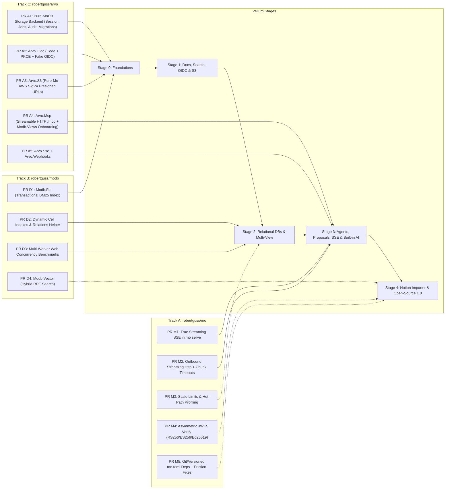

# Vellum — Upstream PR Roadmap (`mo`, `modb`, `arvo`)

> **Companion Spec:** [vellum-spec.md](vellum-spec.md)  
> **Principle:** Vellum is an intentional crucible for **Mo**, **MoDB**, and **Arvo**. Every runtime limitation, missing library primitive, or ergonomics gap discovered while building Vellum is turned into a focused, verified upstream PR—never papered over with fragile app-side hacks.

---

## Dependency Graph Across Repositories

---

## Track A: Upstream PRs in `mo` (`/home/exedev/code/mo`)

Verified against `mo v0.3.0` (`#![forbid(unsafe_code)]`, 17-crate Rust workspace).

### PR M1 — True Streaming SSE in `mo serve` *(Highest Runtime Impact)*

- **Current Gap Verified:**
  - `crates/mo-service/src/api_server.rs` (`dispatch_vm_request`, lines 1146–1318) executes `generation.wire_fn` to completion in an isolated VM process and writes a buffered `Content-Length` HTTP response.
  - `lib/api.mo` (`sse_response`, lines 386–390) currently formats a finite `Bytes` buffer rather than keeping a connection open.
- **Required Upgrade:**
  1. Add a streaming SSE response variant / connection handoff in `api_server.rs` (`Transfer-Encoding: chunked` or raw `text/event-stream` flush loop) bridged to a long-lived in-process `actor` topic hub.
  2. Keep SSE listener connections off the bounded `MO_LIMIT_API_WORKERS` short-request pool (dedicated non-blocking/epoll or bounded SSE slot pool + 15s keepalive `: ping\n\n` heartbeats + clean client-disconnect detection).
  3. Support `Last-Event-ID` replay from an in-memory `actor` ring buffer and deterministic in-memory `ApiTest` capture for `mo test`.
- **Acceptance Criteria:**
  - Multiple concurrent browser `EventSource` clients receive real-time events published by HTTP worker threads with `< 20 ms` latency under `mo serve --workers 8`, survive client drops without leaking file descriptors or starving normal HTTP requests, and pass `ci/check.sh rust`.

### PR M2 — Outbound Streaming `Http` & Long-Lived Stream Timeouts

- **Current Gap Verified:**
  - `lib/http.mo` (`Request`, lines 24–31, 86–97) buffers the entire response body up to `body_limit` (`16777216` bytes) with a single wall-clock `timeout: 30.seconds`.
  - `crates/mo-host/src/network.rs` sets a single connection deadline (`RealConnection.deadline`), and `crates/mo-def/defs/limits.h` (lines 266–271) fixes `MO_LIMIT_API_READ_US` / `MO_LIMIT_API_WRITE_US` at `15s` and `MO_LIMIT_RECEIVE_BYTES` at `1 MiB` per read.
- **Required Upgrade:**
  1. Add incremental chunk / SSE-line reading on `Http` connections (`Http.stream` / `Network.Connection.read_chunk`) with **idle-between-chunks timeouts** rather than total wall-time cutoff, so streaming LLM completions from Anthropic/OpenAI/Gemini can run 60–180s cleanly.
  2. Support forwarding streamed chunks directly out to an active SSE response or `actor` channel.
  3. Maintain 100% deterministic parity on `Network.fake` / `Http.replies` for `mo test`.
- **Acceptance Criteria:**
  - Built-in Ask Workspace streams LLM tokens to browsers end-to-end as they arrive (time-to-first-token `< 100 ms` overhead) and passes zero-socket `mo test` chunked-stream replay tests.

### PR M3 — Scale Limits & Hot-Path Profiling (`limits.h` + `mo-prim`)

- **Current Gap Verified:**
  - `crates/mo-def/defs/limits.h` sets `MO_LIMIT_API_ACTORS = 16`, `MO_LIMIT_API_JOBS = 16`, `MO_LIMIT_API_BODY_BYTES = 16 MiB`, `MO_LIMIT_API_REQUEST_WORK = 67,108,864`, and `MO_LIMIT_API_REQUEST_HEAP = 64 MiB`.
  - `crates/mo-service/src/api_server.rs` (`probe_entry_api`, lines 72–92) treats `api` and MCP `service` as mutually exclusive entry modes.
- **Required Upgrade:**
  1. Benchmark pure-Mo Markdown parsing, block diffing, TipTap JSON conversion, and `Modb.Fts` BM25 scoring on 50 KiB–500 KiB documents against `MO_LIMIT_API_REQUEST_WORK` (`67M`) and `MO_LIMIT_API_REQUEST_HEAP` (`64 MiB`).
  2. Add small, pure-Rust `mo-prim` accelerators *only where benchmarks prove bytecode dispatch is a real bottleneck* (matching how `Json.quote_raw` in `crates/mo-prim/src/json.rs` solved `FRICTION.md` #18)—e.g., fast byte-level text tokenization or `f32` vector dot-product for Phase 2 semantic search.
  3. Review and make configurable (or raise safely with tests) `MO_LIMIT_API_ACTORS` / `MO_LIMIT_API_JOBS` if Vellum's `api` block exceeds 16 jobs/actors, and explore optional ergonomic `mcp` integration inside `api` blocks.

### PR M4 — Asymmetric Signature Verification in `Crypto` *(Enterprise OIDC Hardening)*

- **Current State Verified:**
  - `crates/mo-prim/src/crypto.rs` and `lib/crypto.mo` provide SHA-256, HMAC-SHA256, constant-time compare, AES-256-GCM (`seal`/`open`), scrypt, hex, and base64url in pure safe Rust.
  - Note: Vellum v1 Authorization Code + PKCE (`S256`) works immediately on day one using existing `Crypto` + direct TLS `token_endpoint`/`userinfo_endpoint` validation per OIDC Core §3.1.3.7.
- **Required Upgrade:**
  - Add pure-safe-Rust JWKS JWT verification (`RS256`, `ES256`, `Ed25519`) to `crates/mo-prim` and `lib/crypto.mo` (with zero `unsafe` code) so `Arvo.Oidc` can also verify offline/federated `id_token`s and OIDC bearer JWTs without hitting `/userinfo`.

### PR M5 — Git/Versioned `mo.toml` Dependencies & Language Ergonomics

- **Current Gap Verified:**
  - `crates/mo-check/src/load.rs` (lines 1279–1396) currently supports only `{ path = "...", src = "..." }` inline tables (up to `MO_LIMIT_DEPENDENCIES = 64`) in `mo.toml`.
- **Required Upgrade:**
  - Support Git/tag/rev dependencies and lockfile pinning (`docs/ROADMAP.md` §Next) so open-source Vellum users can clone and build `vellum` standalone without manual sibling checkouts of `arvo` and `modb`.
  - Address any language/compiler ergonomics logged in `vellum/docs/friction.md` (mirroring `modb/FRICTION.md`).

---

## Track B: Upstream PRs in `modb` (`/home/exedev/Projects/modb`)

### PR D1 — `Modb.Fts` (Transactional Pure-Mo BM25 Full-Text Index)

- **Scope:** New `src/modb/fts.mo` module built directly on `Modb.Table` composite keys.
- **Features:**
  - Unicode-aware tokenizer, normalization, stopword filter, positional/frequency postings (`_fts_postings`), and document length stats (`_fts_doc_stats`).
  - Transactional `tx_index_document`, `tx_remove_document`, `tx_reindex_blocks` executing inside the caller's `WriteTx` (zero stale search index; crash-safe via MoDB's dual-fsync CoW commit).
  - Ranked `search(store, query, limit, filter_fn)` using BM25 + prefix-scan matching on trailing tokens for `Cmd+K` instant search.
- **Verification:** Deterministic crash-simulation + differential tests against a reference inverted index + latency benchmarks on 10,000+ documents.

### PR D2 — Dynamic Multi-Value Cell Indexes & Cross-Table Relations

- **Current State Verified:**
  - `src/modb/table.mo` provides typed compile-time `Table(K, V)` and `Index(K, V, I)` descriptors (`encode_composite_key`), while `src/modb/views.mo` provides `ReadProgram`, `Pred`, `SortSpec`, and `AggSpec`.
- **Required Upgrade:**
  - Add dynamic schema-driven multi-index helpers (`DynamicIndex` / composite bucket scans over runtime `PropertyDef.id` + encoded cell values) for `Decimal`, `Date`, `Select`, `MultiSelect` (multi-value index entries), `Bool`, and reverse `Relation` lookups.
  - Add pagination cursors (`after_key`) and range scans aligned with Kanban column counts and Calendar date windows.

### PR D3 — Multi-Worker Web Workload Benchmark & Tuning

- **Scope:** Stress-test MoDB under `mo serve --workers 8+` with mixed Vellum workloads: encrypted session reads/writes, `Arvo.Jobs` polling/claiming, high-frequency `Modb.Claims` heartbeats, `Modb.Fts` updates, and concurrent `Modb.World` proposal diffs.
- **Verification:** Extend `bench/` with a multi-worker wiki+database workload (`0` errors, `0` writer starvation, p95 latency targets, `Modb.verify_fast` clean).

### PR D4 — `Modb.Vector` *(Phase 2/3 Hybrid Search)*

- **Scope:** Store quantized/compact document-chunk embeddings inside MoDB + exact/ann cosine similarity scoring + Reciprocal Rank Fusion (RRF) helper combining `Modb.Fts` BM25 + vector ranks.

---

## Track C: Upstream PRs in `arvo` (`/home/exedev/Projects/arvo`)

### PR A1 — Pure-MoDB Storage Backend for Arvo Core

- **Current Gap Verified:**
  - `lib/arvo/session.mo` (`Sqlite.Database`, `arvo_sessions`), `lib/arvo/jobs.mo` (`arvo_jobs`), `lib/arvo/audit.mo` (`arvo_events`), and `lib/arvo/migrations.mo` (`_arvo_migrations`) all hardcode `Sqlite` today.
- **Required Upgrade:**
  1. Refactor `Arvo.Session`, `Arvo.Jobs`, `Arvo.Audit`, and `Arvo.Migrations` to run natively on **MoDB** (`Modb.Store` / `Modb.Ledger.Db`), mapping `arvo_sessions` (with unique SHA-256 `token_hash` index), `arvo_jobs` (with composite `(state, run_at)` readiness index + `Modb.with_exclusive_lock` claiming), `arvo_migrations`, and bridging `Arvo.Audit` onto `Modb.Ledger`.
  2. Preserve full `Arvo.WebTest` zero-socket in-memory testing parity using `Files.in_memory({})`.
  3. Keep existing SQLite behavior intact (either behind clean adapter modules or alongside `Arvo.Modb.*`) so `hearth-arvo` and `paideia-arvo` never regress.

### PR A2 — `Arvo.Oidc` (OIDC / OAuth2 + PKCE + Deterministic Fake)

- **Scope:** New `lib/arvo/oidc.mo` module.
- **Features:**
  - `.well-known/openid-configuration` discovery with TTL caching.
  - Authorization URL builder with PKCE (`S256` via `Crypto.sha256` + `to_base64url`), `state`, and `nonce`.
  - Encrypted short-lived AEAD state cookie (`Crypto.seal`/`open` + `SecureRandom`).
  - Direct-TLS code exchange and `/userinfo` fetching via `Network.allow_hosts`.
  - Preset configs for Google Workspace, GitHub, Okta, Entra ID, and generic OIDC (like local Dex).
  - Built-in deterministic fake OIDC server helper for `Arvo.WebTest`.

### PR A3 — `Arvo.S3` (Pure-Mo AWS SigV4 Presigner)

- **Scope:** New `lib/arvo/s3.mo` module.
- **Features:**
  - Pure-Mo AWS Signature Version 4 signing (`HMAC-SHA256` key derivation `AWS4` + date/region/service/`aws4_request`) for presigned `PUT`, `GET`, and `DELETE` URLs, plus signed server-to-S3 background reads/writes (for Notion ZIP imports and attachment garbage collection).
  - Path-style & virtual-hosted-style endpoints supporting AWS S3, Cloudflare R2, and MinIO.
- **Verification:** Official AWS SigV4 Test Suite vectors embedded directly in `mo test` `examples`/`test` blocks.

### PR A4 — `Arvo.Mcp` (Reusable Streamable HTTP `/mcp` Server)

- **Scope:** New `lib/arvo/mcp.mo` generalized from `modb/examples/agent-workbench.mo`.
- **Features:**
  - JSON-RPC 2.0 Streamable HTTP handler (`initialize`, `notifications/initialized`, `tools/list`, `tools/call`, `resources/list`, `resources/read`).
  - Typed tool schema helpers, Bearer token → `Modb.Grants` authentication hook, automatic `Modb.Ledger` write metadata injection (`reason`), and `Modb.Views.OnboardingManifest` wiring.

### PR A5 — `Arvo.Sse` & `Arvo.Webhooks`

- **Scope:** `lib/arvo/sse.mo` + `lib/arvo/webhooks.mo`.
- **Features:**
  - **`Arvo.Sse`:** Channel pub/sub, `Last-Event-ID` catchup, presence heartbeats, and typed Inertia/UI live-sync event envelopes built atop PR M1.
  - **`Arvo.Webhooks`:** HMAC-SHA256 payload signing (`X-Signature-256`), replay-safe timestamps, host allowlist enforcement, and durable backoff retries queued through MoDB-backed `Arvo.Jobs`.

---

## Staged Delivery Plan for Vellum

| Stage | Goal | Upstream Gates Required | Vellum Deliverables |
| --- | --- | --- | --- |
| **Stage 0: Foundations** | Prove MoDB-backed Arvo + auth + blobs + search primitives | **PR A1, PR A2, PR A3, PR D1** | MoDB-backed `Arvo.Session`/`Jobs`, `Arvo.Oidc` + Dex local dev, `Arvo.S3` + MinIO, `Modb.Fts` BM25 benchmarks |
| **Stage 1: Core Workspace** | Usable fast wiki replacing Outline | Stage 0 gates | Workspaces, Collections, nested Pages, TipTap ↔ Block-ID/Markdown engine, `Modb.Fts` `Cmd+K` search, S3 attachments, `Modb.Ledger` revision history + Undo |
| **Stage 2: Relational Databases** | Replace Notion Databases | **PR D2, PR D3** *(+ M3 as profiled)* | Typed schemas (`Decimal`, `Date`, `Select`, `Relation`, `Rollup`), dynamic cell indexes, **Table / Kanban Board / Calendar** views, filters & sorts, row-as-page editing |
| **Stage 3: AI-Native & Realtime** | First-class agents + live collaboration | **PR M1, PR M2, PR A4, PR A5** | `/mcp` (`Arvo.Mcp`), `Modb.Grants` + token console, `Modb.Claims` live block/row leases over SSE, `Modb.World` Change Proposals diff inbox, `Modb.Replay` Selective Undo UI, webhooks, streaming Ask Workspace + inline `/ai` + gardening jobs |
| **Stage 4: Migration & Launch** | Switch your work team off Notion & open source | **PR M4, PR M5, PR D4** *(optional/polish)* | Notion Markdown/CSV + API importer, hybrid BM25+vector search, Docker / systemd single-binary docs, public v1.0 release |
