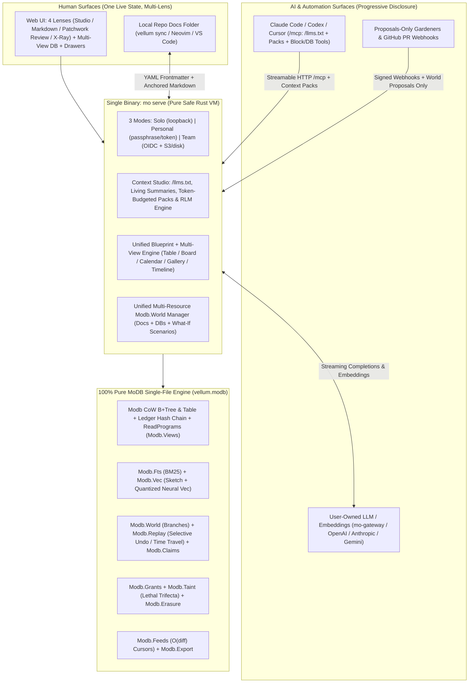

# Vellum v2 — AI-Native Knowledge Platform Vision & Roadmap

> **Status:** Architectural Alignment Locked (Branches 1–6)  
> **Companion Specs:** [vellum-spec.md](vellum-spec.md) · [upstream-roadmap.md](upstream-roadmap.md) · [benchmarks.md](benchmarks.md)  
> **Substrate:** [Mo](https://github.com/robertguss/mo) (Pure Safe Rust VM) · [MoDB](https://github.com/robertguss/modb) (Pure CoW B+Tree / Ledger / FTS / Vec / World / Replay / Views / Feeds / Taint / Erasure) · [Arvo](https://github.com/robertguss/arvo)

---

## 1. Core Thesis: Fuse Local Sovereignty, Team Governance & AI-Native Storage

Modern knowledge tools fall into two broken camps:

1. **Cloud SaaS Wikis (Notion, Confluence, Outline):** Built for human-only editing inside mutable SaaS databases. AI is bolted on afterward as a chat sidebar over nested JSON/HTML blobs—resulting in MCP token bloat, blind overwrites, coarse ACLs, and SaaS lock-in.
2. **Local-First & Flat-File Tools (Obsidian, Statamic):** Loved for speed, clean Markdown ownership, and thoughtful authoring UX (Ghost Koenig's serene card canvas, Statamic's Blueprints + Bard Sets + slide-over drawers), yet they break down on live multi-user concurrency, cross-collection relational queries, headless/remote agent access, or granular agent ACLs.

Vellum sits on a stack with storage-layer capabilities neither camp has natively: copy-on-write **Worlds** (`Modb.World`), selective **Replay** undo (`Modb.Replay`), storage-level **Taint Tracking** (`Modb.Taint`), cryptographic **Erasure** (`Modb.Erasure`), sandboxed **Read Programs** (`Modb.Views`), reactive **Feeds** (`Modb.Feeds`), hierarchical **Grants** (`Modb.Grants`), advisory **Claims** (`Modb.Claims`), hash-chained **Audit Logs** (`Modb.Ledger`), and in-process **BM25 + Vector Search** (`Modb.Fts`, `Modb.Vec`)—all inside **one binary** and **one portable `.modb` file**.

Rather than welding one forced UI onto proprietary blobs, Vellum v2 treats **canonical anchored Markdown (`<!-- blk:<ulid> -->`) + typed Blueprint metadata** as the single source of truth under the hood, and projects multiple first-class **Lenses** on top so developers, finance/ops teammates, writers, and AI agents collaborate on the exact same live state.

---

## 2. Locked Design Decisions (Collaborative Alignment)

| Decision Area | Locked Choice | Why It Matters |
| --- | --- | --- |
| **Delivery Sequencing** | Merge PRs #11 & #12, then build Phase 1 in clean PR slices: `(1) Solo/Personal Auth Modes → (2) Next-Gen DB UX & Unified World Scenarios → (3) Multi-Lens Live Markdown Editor, Blueprints & Embedded DB Views`. | Every slice ships cleanly through `mo test` and `live-e2e.sh` without monolithic integration risk. |
| **Deployment Modes (Branch 1)** | **3 clean modes (`solo` \| `personal` \| `team`)**: (1) **Local Solo**: strictly `127.0.0.1` auto-owner + local disk blobs, zero env setup; (2) **Personal Self-Hosted**: single owner login (passphrase/magic token, no OIDC IdP needed) on VPS/Tailscale; (3) **Team/Enterprise**: OIDC SSO PKCE + S3/disk. | **All 3 modes keep `Modb.Grants`, `Modb.Ledger`, `Modb.World`, and scoped `vlm_ag_...` agent tokens 100% active** so solo builders sandbox agents per collection safely. |
| **Document & Editor Architecture (Branch 2)** | **Canonical Anchored Markdown + 4 Switchable Lenses (`⌘⇧L`)**: **Studio** (Ghost/Bard calm typography + `/` Sets), **Markdown** (direct Markdown + hover `blk_` anchors), **Patchwork/Review** (word-level prose diffs + per-hunk accept/reject + steer-in-place), and **X-Ray/Trust** (`Human` vs `Agent` vs `Tainted` vs drifted + `Modb.Replay` time-travel). | Solves the developer vs. finance/ops divide: zero format lock-in, live SSE sync across Lenses, custom Vellum engine owns schema/diffs/cards with a thin replaceable text-span primitive underneath Studio Lens. |
| **Spaces, Schemas & Drawers (Branch 2)** | **Space (`Collection`) + Schema (`Blueprint`) + Multi-View (`Database`)** split + **Statamic-style slide-over drawers** for `{{metric:...}}` pills, citations, and `Relation` links. | Collections govern ACLs/taint; Blueprints share one `PropertyDef`/`CellValue` engine across structured pages and multi-view databases without forcing schema ceremony on blank notes. |
| **Databases, Branches & AI Columns (Branch 3)** | Inline editing across all 11 cell types + saved-view tabs + visual schema builder + embedded DB blocks; **one Unified Multi-Resource `Modb.World` Branch** engine for multi-page proposals AND DB "What-If Scenarios"; **strictly typed AI-Compiled Columns**. | Eliminates parallel diff engines; AI columns validate via `DatabaseModel.validate_cell` against user-owned LLMs with `Modb.Feeds` triggers, per-column Auto vs. Proposal routing, and daily budgets. |
| **Workspace-as-Memory & Local Sync (Branch 4)** | **3-Layer Progressive Disclosure** (`/llms.txt` index → **Context Studio / Compiled Context Packs** `vellum://packs/<slug>` with hard token budget → surgical `blk_` / `db_query` reads) + conflict-safe two-way `vellum sync`. | Prevents MCP schema/context bloat; sync conflicts never inject `<<<<<<<` markers or overwrite—mismatches open a `Modb.World` Proposal for visual Patchwork resolution. |
| **Autonomous Gardeners & AI Safety (Branch 5)** | **Gardeners strictly Proposals-only**; external imports/webhooks auto-tainted (`TrustTier::Untrusted` in `Modb.Taint`); one-click **Crypto-Erase (`Modb.Erasure`)** for secrets/PII. | Zero silent AI overwrites; Lethal Trifecta blocked structurally at the storage layer; leaked secrets purge cleanly while preserving hash-chain audit integrity. |
| **RLM Deep Research & Living Summaries (Branch 6)** | Hybrid zero-cost **structural summary on every save + debounced semantic summary** on every Page & DB; **3-Speed AI retrieval** (`Speed 1` fast search, `Speed 2` Context Packs, `Speed 3` opt-in Deep Research in 2 tiers: `ReadProgram` slice DSL → read-only `Mo` RLM REPL). | Gives agents an ~50-token metadata map across thousands of docs and runs programmatic slicing/recursive `llm.ask` inside MoDB's budgeted, taint-propagating capability VM—preventing context rot & runaway token spend. |

---

## 3. Who Vellum Serves (On One Binary & One File)

| Segment | Today's Pain | What Vellum v2 Delivers |
| --- | --- | --- |
| **Solo Developers & Indie Builders** | Docker/OIDC/S3 friction locally; agent context drifts away from repos; raw Obsidian vaults lack per-collection agent sandboxing. | **`--solo` mode** in 3 seconds, single `.modb` file, two-way YAML-frontmatter + anchored Markdown `vellum sync`, `/llms.txt` + Context Packs via `/mcp`, per-collection agent tokens. |
| **Personal Self-Hosters & Creators** | Want private cloud access (VPS/Tailscale) without running Dex/Okta; scattered bookmarks & ungrounded notes. | **`personal` mode** (single-owner passphrase/magic login, local disk blobs), sub-millisecond `Modb.Fts` + `Modb.Vec` search, semantic backlinks, structured citation provenance. |
| **Engineering, Finance & Product Teams** | Devs want Markdown, finance wants Notion/spreadsheet clarity; wiki rot; agents making unreviewed edits. | **4 Lenses over one live doc**, Ghost/Statamic Studio Lens + Live `Decimal` Metric Pills `{{metric:...}}`, slide-over inspection drawers, unified Git-like doc+DB Change Proposals, PR-synced runbooks. |
| **Security-Conscious Enterprises** | Prompt injection ("Lethal Trifecta"), leaked keys in wikis, opaque agent permissions, SaaS custody risk. | `Modb.Taint` storage enforcement, one-click `Modb.Erasure` crypto-shredding, scoped/budgeted/expiring `vlm_ag_...` grants, hash-chained audit logs, selective agent rollback. |

---

## 4. System Architecture (v2 Target State)

---

## 5. The Six Unfair-Advantage Pillars

### Pillar 1 — One Binary, One File: Solo, Personal & Team Modes
- **Three Clean Deployment Modes (`routes/auth.mo`, `routes/workspace.mo`):**
  - **`solo` (`VELLUM_MODE=solo` / `--solo`):** Enforces loopback binding (`127.0.0.1` fail-closed if bound to `0.0.0.0` without upgrading mode), auto-creates/attaches local Owner session, auto-persists `0600` `.vellum_secret` in `--data`, and stores attachments on local disk (`<data>/attachments/`). Zero Docker, OIDC, or S3 required.
  - **`personal` (`VELLUM_MODE=personal`):** Designed for solo builders self-hosting on a VPS or Tailscale across devices without setting up Dex/Okta. Single-owner authentication via hashed local passphrase / magic bootstrap token issuing the exact same AES-256-GCM + SHA-256 `sessions.modb` session cookies, backed by local disk or S3 attachments.
  - **`team` (default production mode):** Full OIDC/SSO PKCE S256 (`Arvo.Oidc`), allowed email domains, and S3 SigV4 (`Arvo.S3`) or mounted object volume.
- **Uncompromised Security Floor Across Modes:** `Modb.Grants`, `CollectionWritePolicy`, `Modb.Ledger`, `Modb.Claims`, `Modb.World`, and scoped `vlm_ag_...` bearer tokens stay active in **all three modes**.
- **Two-Way Lossless Local Sync (`vellum sync`):** Mirrors selected collections to a local `./docs/` directory as clean **YAML frontmatter (from Blueprint metadata) + `<!-- blk:<ulid> -->` anchored Markdown**. Developers edit in Neovim, VS Code, or Git branches; teammates stay in the web Studio Lens seamlessly.

---

### Pillar 2 — Multi-Lens Live Markdown, Blueprints & "Git for Knowledge"
- **Space (`Collection`) + Schema (`Blueprint`) + Multi-View (`Database`) Unification:**
  - **Collections** stay the ACL, write-policy, freshness, and default taint boundary (`Engineering`, `Finance`, `Runbooks`, `Personal`).
  - **Blueprints** provide one shared typed property schema (`PropertyDef[]` / `CellValue`s): blank notes start with zero fields, structured docs attach a Blueprint for a clean Statamic-style metadata bar + YAML frontmatter sync, and Databases bind a Blueprint to multi-view tables.
- **Four Instant Lenses Over One Canonical Block Store (`⌘⇧L`):**
  1. **Studio Lens:** Inspired by Ghost's Koenig editor and Statamic's Bard—serene borderless typography, invisible Markdown shortcuts (`## `, `**`, `> `, `- [ ] `), contextual floating selection bar (**Bold / Italic / Link / Code / Comment / Cite / Ask AI**), interactive inline Sets via a tight `/` palette (`Callout`, `Checklist`, `Code`, `Divider`, `Live DB View`, `Live Metric Pill`, `Living AI Brief`), and hover drag handles (`⋮⋮`). Underneath, a clean bespoke Vellum block-tree & card runtime delegates only raw inline prose spans to a replaceable editor primitive.
  2. **Markdown Lens:** Direct fast Markdown editing over exact canonical blocks (`blk_...` gutter anchors on hover), instant paste/terminal ergonomics, and live SSE parity with Studio Lens.
  3. **Patchwork / Review Lens:** Inspired by Ink & Switch's *Patchwork*—word-level prose diffs (soft green additions, margin-pinned deletion pips/before-text, concise change-magnitude summary bars like *"2 sentences · 1 metric ($14.5k → $17.5k)"*), per-hunk Accept/Reject, and **Steer-in-Place** replies asking an agent to revise within the same `Modb.World` branch.
  4. **X-Ray / Trust Lens:** Lights up authorship (`Human` vs `Agent + model`), verified freshness state, **Cited-Dependency Drift** (*"1 cited block changed since verification"*), `Modb.Taint` shields, and an inline **`Modb.Replay` Time-Travel Scrubber**.
- **In-Prose Superpowers & Statamic Slide-Over Drawers:**
  - **Live Exact-`Decimal` Metric Pills (`{{metric:...}}`)** inside narrative Markdown (reflecting Live OR active What-If Scenario totals automatically).
  - **Living AI Brief Cards (`:::ai-brief`)** triggered by `Modb.Feeds` that stage **refresh proposals** rather than silently mutating docs.
  - **Slide-Over Drawer Inspector:** Clicking a metric pill, citation `[blk_...]`, or `Relation` link opens the backing DB rows or source block in a slide-over drawer without losing scroll or writing context.

---

### Pillar 3 — Next-Gen Databases, Unified `Modb.World` Branches & Typed AI Columns
- **Core Relational Ergonomics:** Saved-view header tabs (create, switch, rename, duplicate, delete), inline editing for all 11 column types (`Title`, `RichText`, `Number`, `Date`, `Select`, `MultiSelect`, `Checkbox`, `Person`, `Url`, `Relation`, read-only `Rollup`), visual Schema/Relation/Rollup Builder drawer, drag-and-drop Kanban cards, embedded `DatabaseViewEmbed` blocks inside Pages, Gallery & Timeline views.
- **Unified Multi-Resource `Modb.World` Branches ("Workspace Branches & What-If Scenarios"):**
  - Upgrade `Modb.World` Change Proposals so a **single branch (`world_id`)** stages edits across **multiple Pages + Database rows + Database schemas** atomically.
  - Click **Fork Scenario** inside `/d/:id` to spin up an isolated copy-on-write What-If branch, adjust budgets/priorities/Kanban states, watch a live **Scenario vs. Live exact `Decimal` Rollup Delta Ribbon**, and merge or discard cleanly—all using the exact same Proposal & Diff machinery as agent PRs.
- **Strictly Typed AI-Compiled Columns:**
  - Computed properties that validate outputs straight into typed `CellValue`s via `DatabaseModel.validate_cell` (`SelectVal`, `Decimal`, `DateVal`, `BoolVal`, `RichText`) using the user's own LLM/gateway (no SaaS credit tax).
  - Tracks model + source block citations per cell, detects staleness via `Modb.Feeds`, and enforces **per-column Auto-Apply vs. Stage-as-Proposal** routing plus daily call/budget caps.
- **Full Structured MCP Database Surface (`routes/mcp.mo`):** `vellum.db_query`, `vellum.db_schema`, `vellum.db_create_row`, `vellum.db_update_row`, and `vellum.db_propose_changes`.

---

### Pillar 4 — Living, Self-Healing Knowledge Base (Zero Wiki Rot)
- **Strict "Gardeners Never Write Live" Invariant:** Autonomous gardeners (staleness alerts, `Modb.Vec` near-duplicate & contradiction detection, GitHub PR runbook syncing) may **only open `Modb.World` Change Proposals** with explicit `reason` and `citations`—never overwrite production truth directly, even on `DirectWithAudit` collections.
- **Cited-Dependency Drift:** Because citations reference stable `blk_...` anchors, MoDB detects when cited source blocks change and flags dependent docs + drafts refresh proposals.
- **Codebase-Connected Living Docs:** Signed inbound `POST /api/webhooks/github` webhook matches PR changes against `search_pages_hybrid` and opens targeted `Modb.World` proposals updating affected docs with links back to commits/PRs.

---

### Pillar 5 — Workspace-as-Memory: Living Summaries, Progressive Packs & RLM Deep Research
Built specifically to eliminate the MCP context bloat and "context rot" hitting Notion and Confluence:
1. **Per-Page & Per-DB Living Compact Summaries:** Every Page and Database maintains a compact metadata + ~50-token summary header (`Modb.Feeds`): a **zero-LLM deterministic structural summary** updates immediately on every save (headings, word counts, Blueprint fields, checklist progress, exact `Decimal` rollups), while a **debounced semantic 1-sentence summary** refreshes asynchronously after idle/material diffs.
2. **Layer 1 — Grant-Filtered `/llms.txt` (`vellum://index`):** Compact ~300-token live workspace map of permitted Context Packs, living summaries, pinned docs, schemas, and freshness status.
3. **Layer 2 — Context Studio & Compiled Context Packs (`vellum://packs/<slug>`, `/api/packs/:slug.md`):** Reusable bundles combining collections, pinned pages, saved DB views, and optional semantic queries, filtered by freshness + `Modb.Taint` cleanliness, compiled under a **hard token budget** with a live token meter in the UI and 1-click Copy / MCP URI for Claude Code, Codex, and Cursor.
4. **Layer 3 — Surgical Reads & Typed Queries:** Fetch only exact `<!-- blk:... -->` sections, `vellum.db_query`, or hybrid search hits needed for execution.
5. **Speed 3 — Budgeted, Taint-Tracked RLM Deep Research:** Explicit opt-in mode ("Deep Research (RLM)" in Ask AI & `vellum.rlm_query` in `/mcp`) for complex cross-corpus analysis across thousands of docs and databases without compacting or stuffing context windows:
   - **Tier 1 (Declarative Query/Slice DSL):** Plans over living summaries, slices specific `Heading`/`Callout`/`TaskItem` or matching `blk_...` anchors, joins DB rows via budgeted `Modb.Views.execute_read_program_tainted` (`max_rows_scanned`, `max_ops`, `max_result_rows`), runs bounded parallel sub-LLM calls, and renders a reproducible query trace + clickable citations.
   - **Tier 2 (Sandboxed Read-Only `Mo` RLM Micro-REPL):** Executes capability-confined read-only `Mo` scripts (`ws.summaries`, `ws.blocks`, `ws.db_rows`, `ws.search`, plus budget-capped `llm.ask`) with `max_depth`, `max_subcalls` (debited against `Modb.Grants.max_calls`), and monotonic `Modb.Taint.fork_session` enforcement—zero Python/Docker sandboxes required.
6. **Conflict-Safe `vellum sync`:** When a local `.md` edit diverges from concurrent live edits (`expected_version` mismatch), Vellum **never clobbers files or inserts `<<<<<<<` markers**—instead it stages the local delta into a `Modb.World` Change Proposal resolved visually in Patchwork / Review Lens.

---

### Pillar 6 — Enterprise AI Safety Enforced in Storage
- **`Modb.Taint` Lethal Trifecta Defense:** External imports (`routes/importer.mo`), web clips, and inbound webhooks default to `TrustTier::Untrusted`. Agent searches route through `Modb.Taint.hybrid_search_tainted` (with monotonic `fork_session`), structurally blocking tainted sessions from triggering outbound webhooks or restricted write-downs (`authorize_action`)—enforced by MoDB, not prompt wishes.
- **One-Click Cryptographic Erasure (`Modb.Erasure`):** Scrub leaked keys, tokens, or PII from any block or subject via `Modb.Erasure.erase_subject_locked` (AES-256-GCM key shred + multi-store FTS/Vec/Replay/Audit redaction preserving hash-chain integrity + verifiable `ErasureReceipt`).
- **Agent Control Plane (`/admin`):** Visual `Modb.Grants` sub-delegation tree, live `max_calls` budget gauges, live SSE lease/activity monitor, and instant kill switch.

---

## 6. Phased Execution Roadmap

### Phase 1 — World-Class Core UX & Frictionless Adoption
*Delivered in clean PR slices immediately following PRs #11 & #12.*

| Slice | Deliverables | Primary Touchpoints |
| --- | --- | --- |
| **1.1 Solo & Personal Auth Modes** | `VELLUM_MODE=solo\|personal\|team`, loopback fail-closed guard on `solo`, auto `.vellum_secret`, passphrase/magic-token `personal` login, local disk attachment backend (`<data>/attachments/`), `./scripts/dev-solo.sh`. | `routes/auth.mo`, `routes/workspace.mo`, `main.mo`, `.env.example`, `scripts/dev-solo.sh` |
| **1.2 Next-Gen DB UX & Unified World Scenarios** | Saved-view tabs, inline edit for all 11 cell types, visual Column/Relation/Rollup Builder drawer, drag-and-drop Kanban, Unified Multi-Resource `Modb.World` backend + **"Fork Scenario"** / Live vs. Scenario `Decimal` delta ribbon inside `/d/:id`. | `routes/collab.mo`, `routes/databases.mo`, `db.mo`, `domain/collab.mo`, `frontend/src/pages/Workspace/Database.tsx` |
| **1.3 Multi-Lens Editor, Blueprints & Embedded Views** | 4-Lens switcher (`Studio`, `Markdown`, `Patchwork/Review`, `X-Ray`), ghost-clean borderless Studio typography + `/` Sets menu + drag handles + floating selection toolbar, Statamic `Blueprint` metadata header sharing `PropertyDef`/`CellValue`, `DatabaseViewEmbed` block (`<!-- db_embed:... -->`), slide-over drawer inspector, `{{metric:...}}` live `Decimal` pills. | `domain/types.mo`, `domain/blocks.mo`, `routes/workspace.mo`, `frontend/src/components/BlockEditor.tsx`, `frontend/src/components/EmbeddedDatabase.tsx`, `frontend/src/pages/Workspace/Page.tsx` |

### Phase 2 — AI-Native Workspace Superpowers
| Workstream | Deliverables | Primary Touchpoints |
| --- | --- | --- |
| **2.1 Context Studio, Living Summaries & Progressive Disclosure** | Per-Page/DB structural + debounced semantic **Living Summaries**, grant-filtered `/llms.txt` (`vellum://index`), `ContextPack` MoDB schema, live token-budgeted compiler & UI, `vellum://packs/<slug>` MCP resource, `:::ai-brief` Living Brief cards (`Modb.Feeds`). | `domain/packs.mo`, `db.mo`, `routes/mcp.mo`, `routes/ai.mo`, `frontend/src/pages/Workspace/Packs.tsx` |
| **2.2 Strictly Typed AI-Compiled Columns** | `AiDerived` DB column builder & executor validated via `DatabaseModel.validate_cell`, `Modb.Feeds` staleness tracking, per-column Auto vs. Proposal toggle, daily call/budget cap, citation provenance. | `domain/database-model.mo`, `routes/databases.mo`, `routes/ai.mo`, `frontend/src/pages/Workspace/Database.tsx` |
| **2.3 Full Structured MCP DB Surface** | `vellum.db_schema`, `vellum.db_create_row`, `vellum.db_update_row`, `vellum.db_propose_changes` + `Steer-in-Place` comment threads inside Patchwork Review Lens. | `routes/mcp.mo`, `routes/collab.mo`, `frontend/src/pages/Workspace/Proposals.tsx` |
| **2.4 RLM Deep Research Tier 1 (`ReadProgram` + Block-Slice DSL)** | Explicit "Deep Research (RLM)" Ask AI mode + `/mcp` tool over living summaries, `Modb.Views.execute_read_program_tainted`, block-anchor slicing, bounded parallel sub-LLM synthesis, and inspectable trace + clickable `[blk_...]` citations. | `routes/ai.mo`, `routes/mcp.mo`, `db.mo`, `frontend/src/components/WorkspaceLayout.tsx` |

### Phase 3 — Living Docs, Local Sync & RLM REPL Runtime
| Workstream | Deliverables | Primary Touchpoints |
| --- | --- | --- |
| **3.1 Conflict-Safe `vellum sync`** | Two-way YAML frontmatter + `<!-- blk:... -->` Markdown local mirror routing version conflicts cleanly into `Modb.World` Change Proposals. | Sync command/module in `vellum` + `domain/blocks.mo` |
| **3.2 Proposals-Only Gardeners & PR Bridge** | Contradiction/duplicate detector (`Modb.Vec`), cited-dependency drift detector, signed `POST /api/webhooks/github` PR-to-runbook proposal generator. | `routes/ai.mo`, `routes/collab.mo`, `frontend/src/pages/Workspace/Admin.tsx` |
| **3.3 Visual `Modb.Replay` & DB Gallery/Timeline** | Point-in-time scrubber + selective actor undo simulation UI + Semantic Backlinks rail (`Modb.Vec`) + Gallery & Timeline DB views. | `routes/collab.mo`, `routes/workspace.mo`, `frontend/src/pages/Workspace/{Page,Admin,Database}.tsx` |
| **3.4 RLM Deep Research Tier 2 (`Mo` Micro-REPL VM)** | Read-only capability-confined `Mo` workspace script runner (`vellum.rlm_query`) with `ws.*` + budget-capped `llm.ask`, `max_depth`/`max_subcalls`/`Modb.Grants` debiting, and monotonic `Modb.Taint.fork_session` enforcement. | `routes/ai.mo`, `routes/mcp.mo`, `main.mo` |

### Phase 4 — Enterprise AI Safety Moat
| Workstream | Deliverables | Primary Touchpoints |
| --- | --- | --- |
| **4.1 `Modb.Taint` Lethal Trifecta UI & Enforcement** | Auto-taint external imports/webhooks; route `/mcp` search through `hybrid_search_tainted` + `fork_session`; gate webhooks/writes via `authorize_action`; surface X-Ray taint shields. | `db.mo`, `routes/importer.mo`, `routes/mcp.mo`, `routes/collab.mo`, `frontend/src/` |
| **4.2 One-Click `Modb.Erasure` Secret Purge** | Secret detection hints + Admin/Owner crypto-erase triggering `Modb.Erasure.erase_subject_locked` + downloadable `ErasureReceipt`. | `db.mo`, `routes/workspace.mo`, `frontend/src/pages/Workspace/Admin.tsx` |
| **4.3 Sub-Delegation Control Plane** | Live `Modb.Grants` hierarchy visualizer, token call-budget gauges, live SSE stream, and instant kill switch. | `routes/workspace.mo`, `routes/collab.mo`, `frontend/src/pages/Workspace/Admin.tsx` |

---

## 7. Upstream Coordination (`mo`, `modb`, `arvo`)

As with v1 ([upstream-roadmap.md](upstream-roadmap.md)), upstream primitives are extended cleanly rather than papered over:
- **MoDB (`modb`):** Leverage existing `Modb.World`, `Modb.Replay`, `Modb.Grants`, `Modb.Claims`, `Modb.Fts`, `Modb.Vec`, `Modb.Feeds`, `Modb.Views` (`ReadProgram` + `describe_for_caller`), `Modb.Taint`, `Modb.Erasure`, and `Modb.Export`. Validate multi-bucket `Modb.World` landing invariants for unified page + database branches.
- **Mo (`mo`):** Keep optimizing hot-path allocations, streaming HTTP/SSE ergonomics, sandboxed read-only `Mo` evaluation for Tier 2 RLM queries, and file-watching primitives for `vellum sync`.
- **Arvo (`arvo`):** Support dynamic `Arvo.Mcp` resources (`vellum://packs/<slug>`, `vellum://index`), clean local-disk blob backend parity alongside `Arvo.S3`, and personal-mode local auth helpers.
