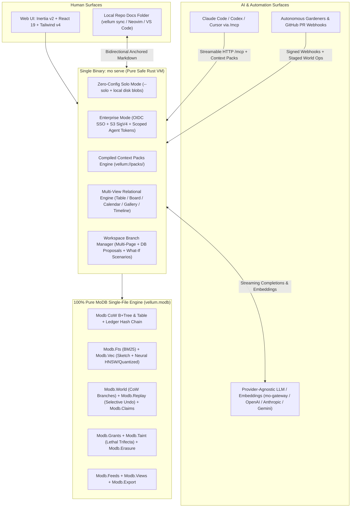

# Vellum v2 — AI-Native Knowledge Platform Vision & Roadmap

> **Companion Specs:** [vellum-spec.md](vellum-spec.md) · [upstream-roadmap.md](upstream-roadmap.md) · [benchmarks.md](benchmarks.md)  
> **Substrate:** [Mo](https://github.com/robertguss/mo) (Pure Safe Rust VM) · [MoDB](https://github.com/robertguss/modb) (Pure CoW B+Tree / Ledger / FTS / Vec / World / Replay / Taint / Erasure) · [Arvo](https://github.com/robertguss/arvo)

---

## 1. Core Thesis: Don't Clone 2019 SaaS Wikis

Modern knowledge tools fall into two broken camps:

1. **Cloud SaaS Wikis (Notion, Confluence, Outline):** Built for human-only editing in mutable SaaS databases. AI is bolted on afterward as a chat sidebar over opaque blobs with weak branching, coarse permissions, external vector pipelines, and SaaS lock-in.
2. **Local-First Note Apps (Obsidian, Logseq):** Fast and sovereign for individuals, but break down as soon as you need governed multi-user teams, relational queries across typed schemas, cryptographic audit trails, or safe multi-agent collaboration.

Vellum sits on a stack with storage-layer capabilities neither camp has natively: copy-on-write **Worlds** (`Modb.World`), selective **Replay** undo (`Modb.Replay`), storage-level **Taint Tracking** (`Modb.Taint`), cryptographic **Erasure** (`Modb.Erasure`), reactive **Feeds & Views** (`Modb.Feeds`, `Modb.Views`), hierarchical **Grants** (`Modb.Grants`), advisory **Claims** (`Modb.Claims`), hash-chained **Audit Logs** (`Modb.Ledger`), and in-process **BM25 + Vector Search** (`Modb.Fts`, `Modb.Vec`)—all inside **one binary** and **one portable `.modb` file**.

The goal for Vellum v2 is simple: fuse **solo local-first speed**, **Git-grade branching for docs + data**, **relational databases with AI-compiled columns**, **living self-healing documentation**, and **storage-enforced enterprise AI safety** into one coherent platform.

---

## 2. Who Vellum Serves (On One Binary & One File)

| Segment | Today's Pain | What Vellum v2 Delivers |
| --- | --- | --- |
| **Solo Developers & Indie Builders** | Docker/OIDC/S3 friction for local tools; agent context (`.md`, specs, tasks) drifts away from codebases. | **Zero-config `--solo` mode**, single `.modb` file, two-way `<!-- blk:... -->` local folder Markdown sync, direct `/mcp` context packs for Claude Code / Codex / Cursor. |
| **Creators, Writers & Researchers** | Scattered bookmarks, untraceable quotes, vector plugins breaking on sync, slow search across big archives. | Fast native sub-millisecond `Modb.Fts` + `Modb.Vec` semantic search, automatic semantic backlinks, structured citation provenance on every paragraph, portable archive export. |
| **Engineering & Product Teams** | Wiki rot, Confluence sprawl, blind overwrites by teammates or bots, spreadsheet-vs-wiki disconnect. | **"Git for Knowledge"** multi-page + database branches, interactive Kanban/Table/Calendar/Timeline views with exact `Decimal` rollups, autonomous PR-synced doc proposals. |
| **Security-Conscious Companies** | Blocking AI tools over prompt injection, secret leakage, un-auditable agent mutations, and vendor SaaS custody. | `Modb.Taint` Lethal Trifecta protection, one-click `Modb.Erasure` secret purge, scoped/budgeted/expiring `vlm_ag_...` tokens, full hash-chained audit & selective agent undo. |

---

## 3. System Architecture (v2 Target State)

---

## 4. The Six Unfair-Advantage Pillars

### Pillar 1 — One Binary, One File: Effortless Solo Mode to Enterprise Scale
- **Motivation:** Teams accept Docker + Dex/Okta + S3 setup; solo developers, creators, and small startups drop tools that take more than 10 seconds to launch.
- **Zero-Config Solo Mode (`--solo` / `VELLUM_SOLO=1`):**
  - Starts cleanly on `mo serve main.mo --solo` with **no Docker, no OIDC provider, and no S3 bucket required**.
  - Auto-provisions or attaches a single local Owner session (strictly bound to `127.0.0.1` unless explicitly configured with shared-secret/OIDC guardrails—never weakening production fail-closed checks).
  - Swaps `Arvo.S3` presigned uploads for a local content-addressed attachment store (`<data>/attachments/`) when S3 env vars are absent.
- **Two-Way Lossless Anchored Markdown Sync (`vellum sync`):**
  - Leverages Vellum's existing `<!-- blk:<ulid> -->` round-trip engine (`domain/blocks.mo`) so any collection can mirror 1:1 to a local directory (e.g., `./docs/`).
  - Developers and coding agents edit plain `.md` files in Neovim, VS Code, or git branches; Vellum reconciles edits back into canonical `Block` records while preserving stable block IDs, block-level provenance, vectors, and relational links.
- **True Single-File Portability:** Everything lives in `vellum.modb` + optional attachments directory—instant backup, git-friendly export via `Modb.Export`, or seamless upgrade from solo laptop to multi-worker team server.

---

### Pillar 2 — "Git for Knowledge": Multi-Page + Database Branches & Time Travel
- **Motivation:** In Notion and Confluence, every keystroke mutates production truth. That forces teams into two bad extremes: zero review guardrails or blocking AI agents from editing important docs altogether.
- **Whole-Workspace Branches (`Modb.World`):**
  - Expand `Modb.World` Change Proposals (`routes/collab.mo`) from single-page edits (`WorldPatchArgs`) to **multi-resource speculative transactions** spanning multiple pages, relational database rows, and database schemas within one World (`base_pin_id`).
  - Example: An agent updating a release spec edits the Architecture Overview, adds a checklist item to the Security Runbook, and marks 3 Q4 Launch Tracker rows as blocked—inside a single atomic branch.
- **Unified Content + Data Diff Viewer (`GET /api/proposals/:id/diff` & `/proposals`):**
  - Render block-by-block Markdown diffs per touched page *plus* row-by-row database cell diffs and **before/after exact `Decimal` rollup impact** (e.g., *"Total Q4 Budget: $17,500.50 → $21,700.50 (+$4,200)"*).
  - **Accept & Land** commits all touched docs and DB rows atomically via `World.land_world_locked` with conflict detection against concurrent human edits.
- **Selective Actor Undo & Time-Travel Scrubber (`Modb.Replay`):**
  - Elevate `Modb.Replay` simulation (`routes/collab.mo`) into a visual Timeline UI on `/admin` and page history sidebars: preview reverting a specific agent run or time window *while keeping subsequent human edits intact*, or scrub any page/database backward across ledger commits (`base_txid`).

---

### Pillar 3 — AI-Native Relational Databases (Beyond Spreadsheets)
Vellum already stores every database row 1:1 as a full `Page` (`domain/database-model.mo`), with `Decimal` exact math, Relations, Rollups, `vlm_db_cells` secondary indexes, and 5 `Ledger` commit invariants.

#### 3A. World-Class Core Database UX (Closing Every Ergonomic Gap)
- **Inline Editing Everywhere:** Click-to-edit Table cells for all 11 types (`Title`, `RichText`, `Number`, `Date`, `Select`, `MultiSelect` multi-pill popover, `Checkbox`, `Person`, `Url`, `Relation` row picker, plus read-only computed `Rollup`).
- **Saved-View Tabs & Persistence:** Top view tab bar rendered directly from `views: DbViewDef[]` (switch views without losing filter/sort state; create, rename, duplicate, reorder, and delete views).
- **Visual Schema & Property Builder Drawer:** Add/edit/reorder columns visually, define `Select` / `MultiSelect` colored choices, and point `Relation` + `Rollup` columns (`count_all`, `count_values`, `sum_values`, `min_value`, `max_value`) with live preview.
- **Embedded Live Database Views in Docs:** New `BlockKind` variant (`DatabaseViewEmbed(database_id, view_id)`) so docs can embed filtered Table/Board slices directly inline (e.g., an incident postmortem embedding its filtered action-items table).
- **Kanban Drag-and-Drop, Calendar Drag/Schedule & Gallery/Timeline Views:** Smooth Kanban card drag across columns plus clean Gallery (card grid backed by row cover/snippets) and Timeline/Roadmap modes.

#### 3B. Capabilities Traditional Databases Don't Have
- **Live-Compiled Agent Columns (`PropertyKind::AiDerived` or reactive column pipeline):**
  - Define typed columns populated automatically from each row's backing page blocks, linked relation rows, and provenance citations (e.g., *"Risk Severity (Select)"*, *"Exec Summary (RichText)"*, *"Missing Runbook Links (Number)"*).
  - Triggered on row/page change via **`Modb.Feeds`** or run on demand; optionally staged into a Change Proposal (`Modb.World`) rather than silently mutating live cells; every derived cell stores source citation + model metadata.
- **One-Click "Fork What-If Scenario" Inside `/d/:id`:**
  - Click **Fork Scenario** on any database to spawn an isolated `Modb.World` copy of that table. Team leads or agents reorder priorities, adjust `Decimal` budgets, or reassign owners; the header displays a **Live vs. Scenario Delta Ribbon** showing net metric/rollup changes before clicking **Merge Scenario** or **Discard**.
- **Full Structured MCP Read/Write (`routes/mcp.mo`):**
  - Extend existing `vellum.db_query` with `vellum.db_schema`, `vellum.db_create_row`, `vellum.db_update_row`, and `vellum.db_propose_changes` (respecting `CollectionWritePolicy` fail-closed).

---

### Pillar 4 — Living, Self-Healing Knowledge Base (Kill Wiki Rot)
- **First-Class Trust, Verification & Citation Strip:**
  - Surface block/page `Provenance` (`Human` vs `Agent + model`, `reason`, `verified_at`, `citations`) cleanly at the top of pages and inline beside cited claims.
  - Detect **Cited-Dependency Drift**: when page A cites block `blk_xyz` on page B and page B changes, flag page A as *"1 cited source updated since last verification"* without waiting for manual calendar reviews.
- **Autonomous Contradiction, Duplicate & Staleness Gardeners (`Modb.Feeds` + `Modb.Vec` + `Modb.World`):**
  - Upgrade `routes/ai.mo` (`garden_job`) from passive reporting to active curation: use `Modb.Vec` nearest-neighbor clusters across newly modified pages to detect conflicting numbers/policies or near-duplicate runbooks, then open concrete **Change Proposals** referencing exact `blk_...` anchors for 1-click human review.
- **Codebase-Connected Living Docs (GitHub PR Webhook Bridge):**
  - Add an inbound webhook endpoint (`POST /api/webhooks/github`, HMAC-verified) that inspects PR diffs/descriptions, finds semantically relevant runbooks/specs via `search_pages_hybrid`, and stages a reviewable Change Proposal updating affected docs alongside a citation link back to the PR.

---

### Pillar 5 — Workspace-as-Memory: Compiled Context Packs & Semantic Graph
- **Compiled Context Packs (`vellum://packs/<slug>` & `/api/packs/:slug`):**
  - Teams and solo devs define reusable **Context Packs** in the UI: select collections, specific databases/saved views, optional semantic focus query, freshness constraint (`verified_within_days`), and strict token budget (e.g. `4,000`, `8,000`, or `16,000` tokens).
  - Vellum compiles a clean, grant-filtered, deduplicated Markdown bundle anchored with `<!-- blk:... -->` IDs and citations.
  - **One URL / One MCP Resource** keeps Claude Code, Codex, Cursor, CI bots, and onboarding chats synchronized with the exact live workspace—respecting caller `Modb.Grants` ACLs on every fetch.
- **Zero-Infra Semantic Backlinks & Topic Map (`Modb.Vec`):**
  - Every page sidebar displays **Related Pages** (`Vec.search` nearest neighbors, scoped by caller grants), **Referenced By** (explicit `PageLink` + database `Relation` backlinks), and **Possible Duplicates**.
  - Workspace **Knowledge Map** (`/graph` or tab) visualizing clusters, orphan pages, stale pockets, and verification health directly from MoDB indexes.

---

### Pillar 6 — Enterprise AI Safety That Actually Unlocks Adoption
- **Lethal Trifecta Defense (`Modb.Taint`):**
  - Expose MoDB's built-in `Modb.Taint` engine inside Vellum: content imported from untrusted external web clips, vendor docs, or public forms carries `tainted` / origin labels at block/page granularity.
  - If an agent reads tainted data during a session, MoDB structurally blocks that session from exfiltrating data via outbound webhooks (`Arvo.Webhooks`), unrestricted writes, or unauthorized reads—enforced deterministically in the database engine rather than via brittle prompt warnings.
- **One-Click Cryptographic Secret & PII Erasure (`Modb.Erasure`):**
  - Detect or report accidentally pasted API keys, tokens, or sensitive PII; let Owners/Admins trigger `Modb.Erasure` directly from Block actions or `/admin` so sensitive payloads are cryptographically scrubbed across history while `Modb.Ledger`'s hash chain remains verifiable.
- **Visual Agent Control Plane (`/admin`):**
  - Live SSE activity stream showing active claims (`Modb.Claims`), open proposals, token burn vs `max_calls` budgets, visual **Monotonic Grant Sub-Delegation Tree** (`Modb.Grants`), and one-click token/grant revocation.

---

## 5. Phased Execution Roadmap

### Phase 1 — World-Class Core UX & Zero-Friction Adoption
*Goal: Make Vellum immediately delightful for solo devs AND dramatically upgrade the Database + Editor UI.*

| Workstream | Deliverables | Primary Touchpoints |
| --- | --- | --- |
| **1.1 Next-Gen Database UI** | Saved-view tab bar (`create`/`switch`/`delete`), inline editing for all 11 cell types (`Text`, `Number`, `Date`, `MultiSelect`, `Url`, `Relation`), visual Column/Relation/Rollup Schema Builder drawer, drag-and-drop Kanban + View counts, Table column visibility & sorting UX. | `frontend/src/pages/Workspace/Database.tsx`, `routes/databases.mo`, `domain/database-model.mo` |
| **1.2 What-If Database Scenarios** | One-click **Fork Scenario** (`Modb.World` branch for DB rows), Scenario vs Live rollup delta banner, atomic **Merge Scenario** / **Discard**. | `routes/collab.mo`, `routes/databases.mo`, `db.mo`, `frontend/src/pages/Workspace/Database.tsx` |
| **1.3 Rich Editor & Embedded Views** | Slash-command menu (`/` for `/h1`, `/callout`, `/code`, `/task`, `/divider`, `/db`), drag-handle block reordering (`MoveBlock`), `DatabaseViewEmbed` block rendering live filtered Table/Board inline inside any Page, clean reading mode vs focused editing chrome. | `frontend/src/components/BlockEditor.tsx`, `domain/types.mo`, `domain/blocks.mo`, `frontend/src/components/EmbeddedDatabase.tsx` |
| **1.4 Zero-Config Solo Mode** | `--solo` / `VELLUM_SOLO=1` startup path bypassing OIDC/S3 containers cleanly with loopback local owner login & local attachment directory (strictly disabled on non-loopback production binds without explicit flag/auth). | `routes/auth.mo`, `routes/workspace.mo`, `main.mo`, `scripts/dev-solo.sh` |

**Phase 1 Exit Criteria:** A developer clones `vellum`, runs `./scripts/dev-solo.sh` with zero Docker/env setup, creates docs with slash commands, embeds a live relational table, forks a What-If budget scenario on Kanban/Table, compares exact `Decimal` rollup deltas, and merges atomically—all passing `mo test` and `./scripts/live-e2e.sh`.

---

### Phase 2 — AI-Native Workspace Superpowers
*Goal: Turn Vellum into live AI memory + structured multi-page agent collaboration.*

| Workstream | Deliverables | Primary Touchpoints |
| --- | --- | --- |
| **2.1 Compiled Context Packs** | `ContextPack` schema in MoDB, CRUD + preview UI, `GET /api/packs/:slug` compiler (grant-filtered, verified-prioritized, deduplicated, strict token budget), native MCP resource `vellum://packs/<slug>` & tool `vellum.compile_pack`. | `domain/collab.mo` (or `domain/packs.mo`), `db.mo`, `routes/mcp.mo`, `routes/ai.mo`, `frontend/src/pages/Workspace/Packs.tsx` |
| **2.2 Multi-Resource Workspace Branches** | Upgrade `Modb.World` proposal actions so one proposal stages ops across N pages + M DB rows/schemas; unified Proposals Inbox diff view showing Markdown block diffs + Database row/rollup diffs. | `routes/collab.mo`, `db.mo`, `domain/collab.mo`, `frontend/src/pages/Workspace/Proposals.tsx` |
| **2.3 Live-Compiled Agent Columns** | `AiDerived` database property configuration + execution worker (`Modb.Feeds` trigger or on-demand batch), citation + model provenance per cell, optional routing through Change Proposals. | `domain/database-model.mo`, `routes/databases.mo`, `routes/ai.mo`, `frontend/src/pages/Workspace/Database.tsx` |
| **2.4 Semantic Backlinks & MCP DB Writes** | Right-hand Page Context rail (`Modb.Vec` Related Docs + Explicit Backlinks + Verification/Dependency Drift status) + full MCP DB tools (`vellum.db_schema`, `vellum.db_create_row`, `vellum.db_update_row`, `vellum.db_propose_changes`). | `routes/workspace.mo`, `routes/mcp.mo`, `db.mo`, `frontend/src/pages/Workspace/Page.tsx` |

**Phase 2 Exit Criteria:** Claude Code / Codex pulls `vellum://packs/eng-architecture` under an 8k token limit respecting grant boundaries; an agent updates 2 docs + 2 tracker rows inside one Change Proposal with unified content + rollup diff; pages display semantic backlinks and verification drift live.

---

### Phase 3 — Living Knowledge & Local Developer Workflows
*Goal: Zero wiki rot for teams + seamless local filesystem workflows for solo builders.*

| Workstream | Deliverables | Primary Touchpoints |
| --- | --- | --- |
| **3.1 Two-Way Anchored Markdown Sync** | `vellum sync` bidirectional watcher/reconciler preserving `<!-- blk:... -->` IDs, provenance, and FTS/Vec indexes between a collection and a local `./docs/` directory. | New CLI subcommand or sync module in `vellum` + `domain/blocks.mo`, upstream check on `mo` filesystem watch needs (`docs/upstream-roadmap.md`). |
| **3.2 Autonomous Gardener Proposals & PR Sync** | `Modb.Vec` duplicate/contradiction detector proposing concrete fixes via `Modb.World`; signed `POST /api/webhooks/github` PR-to-runbook proposal generator. | `routes/ai.mo`, `routes/collab.mo`, `frontend/src/pages/Workspace/Admin.tsx` |
| **3.3 Visual `Modb.Replay` Time-Travel UI** | Interactive simulation & point-in-time diff preview in `/admin` and per-page revision history (`Replay.simulate_replay_locked`), plus per-block restore. | `routes/collab.mo`, `routes/workspace.mo`, `frontend/src/pages/Workspace/Admin.tsx`, `frontend/src/pages/Workspace/Page.tsx` |
| **3.4 Timeline & Gallery Views** | Rich Gallery cards and Date-range Timeline / Roadmap Gantt view on top of existing `DateProp(start, end_date)` storage. | `frontend/src/pages/Workspace/Database.tsx`, `domain/database-model.mo` |

---

### Phase 4 — Enterprise AI Safety Moat
*Goal: Make MoDB's structural AI safety guarantees accessible and verifiable to enterprise security teams.*

| Workstream | Deliverables | Primary Touchpoints |
| --- | --- | --- |
| **4.1 `Modb.Taint` Lethal Trifecta Integration** | Tag untrusted imports (`Notion` / web clips / external hooks) in MoDB; enforce taint propagation checks across `Modb.World`, `/mcp`, and outbound `Arvo.Webhooks`; display Taint badges & policy audit blocks in UI. | `db.mo`, `routes/importer.mo`, `routes/mcp.mo`, `routes/collab.mo`, `frontend/src/` |
| **4.2 One-Click `Modb.Erasure` Secret Purge** | Secret/PII detector hint + Admin/Owner **Cryptographic Erase** action scrubbing block/audit secrets while keeping hash-chain integrity intact. | `db.mo`, `routes/workspace.mo`, `routes/collab.mo`, `frontend/src/pages/Workspace/Admin.tsx` |
| **4.3 Sub-Delegation Control Plane** | Interactive `Modb.Grants` hierarchy tree, live budget gauges (`calls_used / max_calls`), live SSE agent stream, and one-click kill switch in `/admin`. | `routes/workspace.mo`, `routes/collab.mo`, `frontend/src/pages/Workspace/Admin.tsx` |

---

## 6. Upstream Coordination (`mo`, `modb`, `arvo`)

As with v1 ([upstream-roadmap.md](upstream-roadmap.md)), any missing runtime or library capability discovered across Phases 1–4 is implemented cleanly upstream rather than hacked around in app code:

- **MoDB (`modb`)**: Already ships `Modb.World`, `Modb.Replay`, `Modb.Grants`, `Modb.Claims`, `Modb.Fts`, `Modb.Vec`, `Modb.Feeds`, `Modb.Views`, `Modb.Taint`, `Modb.Erasure`, and `Modb.Export`. Verify multi-bucket `World` invariants when mixing `Table` writes on pages + DB rows in one branch, and evaluate incremental `Modb.Views` materialization for live Rollups and Context Packs.
- **Mo (`mo`)**: Keep monitoring batch/hot-path allocations (`Bytes` primitives, streaming JSON/SSE throughput, file-watch ergonomics for `vellum sync`).
- **Arvo (`arvo`)**: Keep `Arvo.Mcp` resources/tools ergonomics aligned for dynamic `vellum://packs/<slug>` URIs and local-disk storage option alongside `Arvo.S3`.

---

## 7. Open Design Decisions for Phase 1 (`/grill-me` Checklist)

Before writing Phase 1 code, lock these concrete UX and schema decisions:

1. **Solo Mode Security Boundary:** Should `--solo` enforce loopback-only binding (`127.0.0.1`) at startup and prompt/require OIDC or a local passphrase/token if someone tries `--bind 0.0.0.0`?
2. **Default Workspace Surface on Launch:** Should `/` open to a crisp command dashboard (recent docs, pinned databases, active Change Proposals, Context Packs) or jump directly into a Notion/Obsidian-style last-opened page + collapsible sidebar?
3. **Slash Commands & TipTap Editing UX:** Should clicking anywhere on a block seamlessly enter inline editing without showing per-block borders in reading mode (document canvas feel), with hover drag handles (`⋮⋮`) and provenance dots (`● Human` / `◆ Agent`) cleanly docked in the margin?
4. **What-If Scenario Scope in Phase 1:** Start with **Database Scenarios** (forking a DB's rows + rollups inside `/d/:id`) in Phase 1, then generalize the exact same `Modb.World` multi-op engine to **Workspace Scenarios** (N pages + M DBs) in Phase 2?
5. **Embedded Database Views Schema:** Add `DatabaseViewEmbed(database_id, view_id, height_mode)` to `BlockKind` (requires checking `domain/blocks.mo` anchored Markdown projection round-trip, e.g., `<!-- db_embed:db_...:vw_... -->`).
