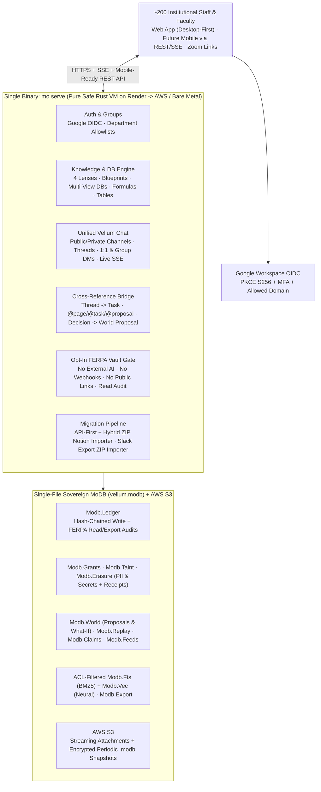

# Vellum v3 — Sovereign Institutional Workspace Blueprint

> **Status:** Locked Architecture, Milestone 0 Baseline Verified & Execution Plan  
> **Builds On:** [Vellum v2 Vision & Roadmap](v2-vision-and-roadmap.md) (Phases 1.1–4.3 shipped & merged on `main`)  
> **Target Environment:** ~200-seat Education / Non-Profit / Enterprise Teams · Google Workspace OIDC · Render → AWS / Bare Metal  
> **Milestone 0 Audit Tool:** [scripts/notion-audit.mjs](../scripts/notion-audit.mjs)

---

## 1. Executive Thesis & Institutional Story

Replacing SaaS wikis/databases (~$30k+/yr) and Enterprise Chat gets Finance in the door. **What wins Leadership, IT, Legal, and Compliance is closing the institutional FERPA, PII, and AI-security gap:**

1. **The SaaS Gap Today:** Multi-tenant cloud wikis and chat platforms involve third-party custody, coarse workspace sharing risk, and evolving AI/vendor data policies. As a result, institutions **still have no safe, collaborative workspace** for sensitive student or client records (advising, accommodations, student care, financial aid, admissions), pushing sensitive workflows into ad-hoc emails, local spreadsheets, and DMs.
2. **Vellum's Sovereign Alternative:** One pure safe-Rust binary (`mo serve`) and one portable `.modb` database (+ customer-owned AWS S3 for encrypted snapshots and attachments), authenticated solely through organizational SSO:
   - **Customer-held custody & zero cluster sprawl:** Runs on Render today (persistent disk + encrypted AWS S3 snapshots) and moves cleanly to an AWS VPC or customer-owned bare-metal/on-prem servers later—zero Postgres, Redis, or Elasticsearch clusters to migrate.
   - **Zero-friction daily defaults + Opt-in FERPA Vaults:** Everyday Collections stay fast and ergonomic; flipping **`FERPA / Restricted Vault`** on sensitive Collections enforces strict department allowlists across Pages, Databases, Chat, Search, and Backlinks, hard-blocks external LLMs/webhooks/public links, and logs every **read & export** in `Modb.Ledger`.
   - **Cryptographic defense against malicious AI & accidental leaks:** Storage-level `Modb.Taint` blocks prompt-injected exfiltration, scoped `Modb.Grants` + Kill Switch contain any automation, and extended PII detection triggers one-click **`Modb.Erasure`** crypto-shredding with a downloadable compliance `ErasureReceipt`.
   - **Docs + Relational Databases + Team Chat inside one security boundary:** Staff can click any thread in **Vellum Chat** to create a linked Database task, `@mention` Pages/Tasks/Proposals with permission-safe previews, or promote a team decision straight into a reviewable `Modb.World` doc change proposal.

---

## 2. Locked Design Decisions

| Decision Area | Locked Choice | Why It Matters |
| --- | --- | --- |
| **Target Org & Scale** | **~200 staff/faculty seats** | Single `mo serve` process handles 200-person HTTP/SSE concurrency comfortably with minimal ops overhead. |
| **Primary Auth / SSO** | **Google Workspace OIDC** (`accounts.google.com` PKCE S256 + `VELLUM_OIDC_ALLOWED_DOMAINS`) | Zero new passwords; leverages organizational MFA and directory lifecycle (`routes/auth.mo`). |
| **Hosting Trajectory** | **Render (persistent disk + AWS S3)** for pilot/rollout → **AWS VPC / on-prem bare metal** long term | Single `.modb` file + S3 keeps Render setup simple while guaranteeing seamless future on-prem portability. |
| **Migration & Demo Strategy** | **Real Notion workspace migrated faithfully** (audited via API + ZIP outside git) + FERPA Vault + Vellum Chat + PII Erasure | Shows stakeholders their *own* pages, relational databases, and workflows live instead of synthetic dummy data. |
| **Security UX Model** | **Opt-in `FERPA / Restricted Vault` per Collection** (`Standard` vs `Restricted`) | Avoids daily friction on general wikis while delivering strict FERPA controls where sensitive student data lives. |
| **PII & Leak Containment** | **All 4 FERPA controls + global PII scanner:** Department Groups, External-AI/Webhook/Public-Link lock, Read/Export `Modb.Ledger` audit log, PII `Modb.Erasure` + Receipts | Even if an SSN/Student ID lands in a *Standard* page or channel, one click crypto-shreds it and produces an audit receipt. |
| **Unified Vellum Chat** | **Built into Vellum** inside the Collection ACL/Ledger/Erasure boundary: public & private channels, threaded replies, 1:1 & group DMs, live SSE | Eliminates dual ACLs, dual search, and dual compliance tools across Slack and Notion. |
| **Mobile, Voice & External Chat** | **Desktop-first + versioned REST & SSE API** ready for future mobile apps; **Zoom** for calls (no Huddles); **Slack Connect deferred** | Keeps v3 scope crisp around high-value chat + knowledge workflows while designing clean API contracts for mobile. |
| **Slack Migration** | **Slack Export ZIP Importer** (supporting last-N-days seed for demo or searchable archive import) | Preserves institutional chat history and makes cutover practical without running two chat platforms. |

---

## 3. Target System Architecture

---

## 4. Milestone 0 Empirical Audit Findings (Anonymized Structural Baseline)

Before writing importer or UI parity code, a production team Notion workspace was audited using [scripts/notion-audit.mjs](../scripts/notion-audit.mjs) across **both** the live read-only Notion REST API and a complete Notion Markdown & CSV Export ZIP. Five concrete architectural facts emerged:

### 4.1 Workspace Scale & Attachment Streaming Requirement
- **939** API pages (**856** database row pages, **78** nested subpages up to **folder depth 6**, **5** root pages) and **968** exported Markdown files totaling only **6.68 MiB** of prose (largest single page: `0.13 MiB`).
- **26** exported CSVs (**1.69 MiB**) mapping to **18** canonical Notion databases (`2` inline, `16` full-page).
- **210** attached non-page files totaling **472.94 MiB**, of which **92% (435.23 MiB)** consists of **3 large `.mp4` videos** (up to **208.82 MiB** single file), while the other 207 files (images, JSON backups, PDFs, Office docs) total **~37.7 MiB** (max `3.27 MiB`).
- **Implication:** Importers must **never** bundle raw attachments inside `POST /api/import/notion` JSON payloads. Pages and DB rows stream cleanly in small batches while attachments stream per-file directly via Vellum's attachment storage (S3 presign PUT or chunked disk upload).

### 4.2 Why Notion Import Must Be API-First (With Hybrid ZIP Quirks Handled)
Comparing the Export ZIP directly against the Notion REST API uncovered three critical CSV export traps:
1. **Embedded Linked DB Views Export as Duplicate `"Untitled"` CSVs:** Notion exported **26** CSVs for **18** real databases—embedded filtered views on dashboard pages materialized as redundant `"Untitled"` CSVs sharing identical column headers.
2. **Default-View CSVs Silently Drop Columns:** Large project/task tables exported with only 5–7 visible columns in `<Title>.csv`, whereas **42** properties (including `Status`, `Relation`s, and `Formula`s) lived only in the API and `<Title>_all.csv`.
3. **Nested Part ZIPs & UTF-8 Filename Encoding:** Large Notion exports bundle inner part `.zip` archives and can trigger CP437 filename encoding mismatches on Unicode punctuation when unzipped naïvely.

**Decision:** Build an **API-First Notion Migration Engine** (canonical DB schemas, exact 36 relations, formulas, option colors, `parent_page_id`, and rich blocks without duplicate `"Untitled"` tables), while upgrading the ZIP importer to handle nested ZIPs, UTF-8 names, `*_all.csv` priority, and offline attachment mirroring.

### 4.3 Empirical Milestone 1 Parity Matrix

| Feature Area | Observed Production Usage | Priority & Plan |
| --- | --- | --- |
| **GFM `Table` Block** | **211** `table` / **1,686** `table_row` blocks (`2,386` Markdown table lines) | **P0 (Slice 1.1)** — Add native `Table` `BlockKind`, Markdown parser/serializer, and Studio editor table UI |
| **`Heading(4)` & `Toggle`** | **590** `heading_4`, **22** `toggle`, **3** `transcription`, **1** `table_of_contents` | **P0 (Slice 1.1)** — Support H4 headings, collapsible `Toggle` blocks, and structured `transcription` notes |
| **Streaming Attachments** | **134** API media/file blocks (`103` file, `30` image, `1` pdf), **210** ZIP files up to **209 MiB** | **P0 (Slice 1.1)** — Per-file streaming upload/mirror into S3/disk with block + DB `Files` linking |
| **Hierarchy & Inline DBs** | **78** `page_id` subpages (`54` `child_page`, max depth **6**), **26** `child_database`, **87** icons | **P0 (Slice 1.3)** — Preserve full `parent_page_id` tree, icons/covers, and `DatabaseViewEmbed` links |
| **Relations & Rollups** | **36** `Relation` cols (single, dual/bidirectional, self-relations) + **1** `Rollup` (`percent_per_group`) | **P0 (Slice 1.2–1.3)** — Add `PercentPerGroup` rollup + 2-pass multi-DB schema & row-link wiring |
| **Notion Formula Subset** | **10** formulas across 4 DBs: `if`/`ifs`, `empty`, arithmetic, `round`/`floor`, `format`/`repeat`, `formatDate(..., "YYYY-MM")`, related `.length()` & `.filter(current.prop(...) == ...)` | **P0 (Slice 1.2)** — Deterministic Notion-subset `Formula` evaluator inside `Domain.DatabaseModel` |
| **Missing DB Prop Types** | **7** `Status`, **3** `Email`, **2** `Files`, **8** audit cols (`Created*`/`LastEdited*`), **1** `UniqueId`, **1** `Place` | **P0 (Slice 1.2)** — First-class `Status`, `Email`, `Files`, `UniqueId`, computed audit columns, and `Place` label |
| **Explicitly Deferred** | **0** public pages/DBs, **0** `synced_block`, **0** `column_list`, **0** `equation`/`bookmark`/`embed`/`video` | **Skip in M1** — Do not overbuild unused Notion primitives |

---

## 5. Phased Execution Roadmap

### Milestone 1 — Seamless Notion Migration & Parity *(3 Clean PR Slices)*
- **Slice 1.1 — Block & Streaming Attachment Parity:**
  - Native `Table` (`BlockKind.Table`), `Heading(4)` preservation, collapsible `Toggle` blocks, and `transcription`/`table_of_contents` handling across [domain/types.mo](../domain/types.mo), [domain/blocks.mo](../domain/blocks.mo), [BlockEditor.tsx](../frontend/src/components/BlockEditor.tsx), and Patchwork/X-Ray lenses.
  - Streaming per-file attachment upload/mirroring endpoint & ZIP/API helper capable of handling 200+ MiB files without buffering batches into JSON.
- **Slice 1.2 — Database Schema & Formula Parity:**
  - Add `Status`, `Email`, `Files`, `UniqueId`, `CreatedTime`/`CreatedBy`/`LastEditedTime`/`LastEditedBy`, and `PercentPerGroup` Rollup aggregation to [domain/database-model.mo](../domain/database-model.mo), [routes/databases.mo](../routes/databases.mo), and [Database.tsx](../frontend/src/pages/Workspace/Database.tsx).
  - Implement deterministic `Formula` evaluation supporting arithmetic, `if`/`ifs`, `empty`/`not`/`or`/`==`, `round`/`floor`/`format`/`repeat`, `formatDate(..., "YYYY-MM")`, and related-row `.length()` / `.filter(current.prop("...") == ...)`.
- **Slice 1.3 — API-First & Hybrid ZIP Migration Engine:**
  - Upgrade [domain/notion-import.mo](../domain/notion-import.mo), [routes/importer.mo](../routes/importer.mo), and a resumable Notion API + ZIP migration CLI/UI workflow:
    - Pass 1: Create Collections/nested Pages (`parent_page_id`, icons/covers) and all Database definitions (avoiding `"Untitled"` view duplicates; prioritizing `*_all.csv` / API schemas).
    - Pass 2: Stream attachments, resolve `DatabaseViewEmbed`, populate rows, and wire all cross-DB `Relation` links + dual inverses + self-relations + Formulas/Rollups.
  - Validate end-to-end against real anonymized/disposable fixtures covering depth-6 nesting, 18-DB relational graphs, formulas, and tables.

### Milestone 2 — Opt-In FERPA Sovereign Vault & Enterprise Ops
Make Institutional IT, Security, and the Registrar comfortable hosting sensitive student records inside Vellum without slowing down everyday users:
- **Collection Security Tiers (`Standard` vs. `FERPA_Restricted`):**
  - **Standard Collection (default):** Minimal friction—normal workspace role rules, AI features enabled, embeds allowed when permitted.
  - **FERPA / Restricted Vault Collection (opt-in toggle):**
    1. **Strict Department Group & User Allowlists:** Explicit Collection membership groups (e.g., `Registrar`, `Financial Aid`, `Student Care`). Non-members receive `403/404`, and Pages/DBs/Chat/Search/Backlinks/Context Packs/`/llms.txt`/RLM filter out restricted collections completely so neither titles nor snippets ever leak.
    2. **Zero External AI / Zero Exfiltration Lock:** Hard-blocks external SaaS LLM calls (`Modb.Feeds` AI columns, `:::ai-brief`, Ask AI, RLM external models) unless explicitly bound to an approved campus/local-only endpoint; hard-blocks outbound webhooks and public share links on that Collection.
    3. **Read & Export Audit Logging in `Modb.Ledger`:** Logs view events (`page.viewed`, `db_row.viewed`, `attachment.downloaded`, `chat.channel_viewed`, `export.requested`) with principal, timestamp, session metadata, and reason when viewing Restricted collections.
- **Extended PII Detection & One-Click `Modb.Erasure` (`domain/secrets.mo`, `erasure-ops.mo`):**
  - Expand `Domain.Secrets.scan_text` with calibrated PII detectors (SSNs, Institutional/Student ID formats, bank/routing indicators, credential + PII risk classification) with false-positive guards and masked previews.
  - Extend `Modb.Erasure` purge flow to scrub **both Knowledge Pages/DBs and Chat messages/attachments** cleanly across FTS/Vec/Ledger/Replay caches and export verifiable JSON `ErasureReceipt` artifacts.
- **Production Operations & Hosting (Render → AWS / Bare Metal):**
  - Verify **Google Workspace OIDC** login, verified-email + allowed-domain enforcement, and session idle/absolute lifetimes.
  - Automated **Encrypted Snapshot Backup & Verified Restore** shipping consistent `Modb.Export` / `.modb` backups to AWS S3 on a schedule, with a documented restore drill test.
  - Ready-to-deploy Render configuration (persistent disk + AWS S3 env setup) and AWS/bare-metal portability runbook.

### Milestone 3 — Unified Vellum Chat (Enterprise Chat Replacement)
Unify team communication and knowledge inside one clean, API-first surface:
- **Core Messaging Primitive (Restrained, High-Signal UX):**
  - **Public & Private Channels:** Scoped inside Collections inheriting Collection ACLs, `FERPA / Restricted` locks, and `Modb.Erasure`.
  - **Threads, 1:1 & Group DMs, Reactions & File Shares:** Root messages with expandable side-threads (keeping main channels calm), direct messages (`vlm_chat_dms`), emoji reactions, and S3/disk file attachments.
  - **Calm Notification Model:** Unread badges + `@mention` / thread-reply inbox integrated cleanly without overwhelming document authoring.
- **Deep Knowledge ↔ Chat Cross-Referencing (The Vellum Moat):**
  - **1-Click Thread → Database Task:** Convert any chat message or thread into a typed `DbRow` inside a selected project Database with a **live bidirectional reference pill** (task status/assignee updates render in-thread, and opening the task shows the originating chat discussion).
  - **Inline `@page` / `@task` / `@proposal` / `@thread` Citations:** Type `@` or `#` in chat to link live Vellum entities with **ACL-safe inline cards** (hidden/redacted if a viewer lacks Collection access—crucial across FERPA vs. Standard boundaries).
  - **Decision → Living Doc (`Modb.World`):** Flag a thread as a Decision and click **"Draft Doc Update"** to spin up a `Modb.World` Change Proposal against the linked Handbook/Runbook with clickable citations back to the chat thread.
- **Mobile-Ready REST & SSE API Contract (`/api/v1/chat/...`):**
  - Paginated cursor endpoints (`before`/`after` message cursors), idempotent client send keys, unread/ack endpoints, search filters across chat + docs, and unified SSE event stream (`/api/v1/events`) ready for future iOS/Android clients or PWA Web Push.
- **Slack Export ZIP Importer:**
  - Parses standard chat workspace exports (`users.json`, `channels.json`, daily JSON logs preserving `thread_ts` replies and files) with `--since-days` support (e.g., seed demo channels with the last 30 days of activity or import full searchable archives into Read-Only Archive Collections).

---

## 6. Target 5-Minute Executive Demo Script

1. **Google SSO → Live Team Workspace (90s):** Sign in with organizational Google SSO and browse the *actual* team handbook, nested depth-6 pages, tables, and 18-database relational workspace running natively in Studio Lens, Board/Calendar/Timeline DB views, and formula progress bars.
2. **Chat + Tasks + Docs Working Together (90s):** Open a team Chat channel, jump into a threaded discussion referencing `@Handbook`, click **"Create Task"** to spawn a linked DB row with a live status pill in chat, and update its status on Kanban.
3. **FERPA Vault in Action (90s):** Switch into a `FERPA / Restricted Vault` Collection. Show that a non-member account cannot see the pages, channels, or search hits; show external AI features locked; view a sensitive record and inspect the live **`Modb.Ledger` Read Audit** entry.
4. **Accidental PII Leak → One-Click Crypto-Erasure (30s):** Paste a sample SSN/token into a test note/message, watch Vellum's scanner flag it in Admin, click **Crypto-Purge**, confirm search returns 0 hits, and download the **`ErasureReceipt`**.
5. **The Closer (~$30k+ Saved + Total Sovereignty):** One Rust binary + one portable `.modb` file + customer-owned AWS S3/Render deployment—portable onto on-prem bare metal at any time.
