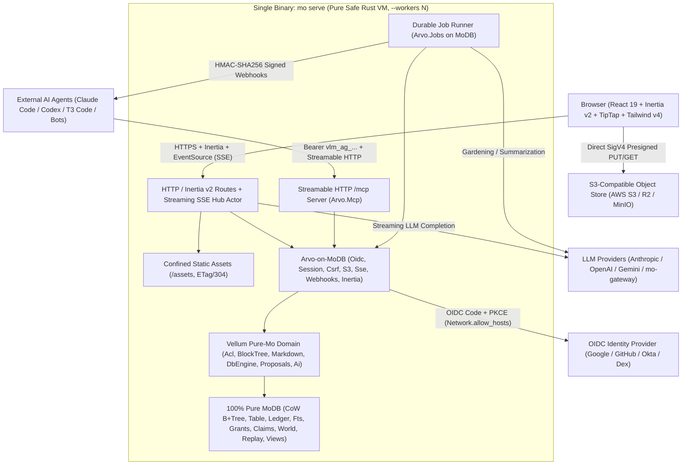

# Vellum v1 — Architecture & Technical Specification

> **Status:** `v0.1.0-spec` (Locked Decisions: 2026-11-26)  
> **Companion Plan:** [upstream-roadmap.md](upstream-roadmap.md)  
> **Siblings:** [Mo](https://github.com/robertguss/mo) · [MoDB](https://github.com/robertguss/modb) · [Arvo](https://github.com/robertguss/arvo)

---

## 1. Vision, Scope & First Principles

**Vellum** is an open-source, self-hostable, AI-native collaborative workspace designed to replace Notion, Outline, and Confluence for engineering and operations teams—while serving as **Crucible App #3** to battle-test **Mo**, **MoDB**, and **Arvo** under full-scale multi-user and multi-agent workloads.

### Core Product Scope (v1)

1. **Nested Docs & Collections (Outline + Notion Docs):** Hierarchical collections, arbitrarily nested pages, canonical block-tree storage with bidirectional Markdown, slash commands, inline comments, `@mentions`, revision history, and instant BM25 search.
2. **Relational Databases & Multi-View Engine (Notion Databases):** User-defined typed schemas (`Text`, `Number` via exact `Decimal`, `Date`, `Select`, `MultiSelect`, `Checkbox`, `Principal`, `Url`, `Relation`, `Rollup`) where every row is simultaneously a full Vellum `Page`, backed by saved **Table**, **Kanban Board**, and **Calendar** views with composable filters and sorts.
3. **First-Class Agent & AI Collaboration:**
   - **External Agents:** Native Streamable HTTP **`/mcp`** endpoint, HMAC-signed outbound **webhooks**, scoped Agent Capability Tokens, attenuated `Modb.Grants`, advisory block/row `Modb.Claims`, speculative `Modb.World` Change Proposals, and `Modb.Replay` selective rollback.
   - **Built-in AI:** Provider-agnostic streaming LLM client (Anthropic, OpenAI, Gemini, OpenAI-compatible/`mo-gateway`) powering streaming **Ask Workspace** with clickable block citations, inline slash-command drafting into claimed preview blocks/proposals, and scheduled **knowledge-gardening** background jobs.
4. **Deployment & Security Model:**
   - **100% Pure MoDB** persistence (zero SQLite anywhere in Vellum or its Arvo layer).
   - **OIDC/SSO-only** human authentication (no local passwords) + SHA-256-hashed Agent Capability Tokens.
   - **S3-compatible object storage** (AWS S3, Cloudflare R2, MinIO) via pure-Mo AWS SigV4 presigned URLs.
   - **Single compiled binary** (`mo serve`) serving Inertia v2 + React 19 + Tailwind v4 static assets, HTTP/JSON APIs, streaming SSE, `/mcp`, and background jobs—zero Node or Redis in production.

### Design Tenets

- **Ordinary Team Workspace as Base Case, Agents on the Exact Same Substrate:** Humans and agents never use parallel, out-of-sync APIs or permissions. Every UI click, `/mcp` call, and built-in AI action passes through the same capability checks, `Modb.Ledger` audit chain, and `Modb.Claims` / `Modb.World` machinery.
- **No Bolted-On RAG or Opaque Blobs:** Documents have stable ULID block IDs (`blk_...`) and lossless Markdown projection so agents read and patch exact blocks rather than scraping HTML or clobbering whole JSON trees.
- **Fail-Closed Everything:** Missing grant, expired claim, stale CoW world read, unverified OIDC state, or invalid relation reference rejects cleanly with typed errors and zero partial writes.
- **Zero-Socket Deterministic Testing:** All domain logic, OIDC exchanges, S3 presigning, SSE broadcasts, LLM streams, `/mcp` tools, and full Inertia flows execute deterministically under `mo test` using Mo's in-memory capability fakes.

---

## 2. System Architecture



### Request, Stream, and Isolation Model

- **HTTP & Inertia Requests:** Each request executes inside its own isolated Mo VM process and heap (`mo serve` worker pool), reading MoDB via lock-free optimistic CoW snapshot verification (`Modb.with_shared_lock` / `Ledger.read_locked`) and serializing writes cleanly via exclusive locks (`Ledger.locked`).
- **True Streaming SSE (`GET /events/stream` & Ask AI streams):** Long-lived chunked `text/event-stream` responses connect to an in-process pub/sub `actor` (not occupying short-lived HTTP worker threads) with bounded `Last-Event-ID` ring buffers for reconnect catchup.
- **Durable Background Jobs (`Arvo.Jobs` on MoDB):** Scheduled and event-triggered jobs (webhook delivery, knowledge gardening, Notion ZIP import, S3 orphan sweep) run in isolated job processes with narrowed `Network.allow_hosts` capabilities and exponential backoff retries.

---

## 3. Principals, OIDC-Only Auth & Hierarchical Capability Grants

### 3.1 Unified Principal Model

Every human and agent in a Vellum workspace is represented by a single `Principal` identity so ownership, comments, claims, proposals, and `Modb.Ledger` audit entries treat them uniformly. Note: `actor` is a reserved keyword in Mo, so fields consistently use `principal`, `actor_id`, or `author_id`.

```mo
enum PrincipalKind
  Human
  Agent
end

enum WorkspaceRole
  Owner
  Admin
  Member
  Guest
  Bot
end

struct Principal
  id: Text                  # "usr_01J..." or "agt_01J..."
  kind: PrincipalKind
  handle: Text              # "@alice", "@docs-gardener"
  display_name: Text
  email: Option(Text)       # Some(...) for Human (OIDC), None for Agent
  avatar_url: Option(Text)
  role: WorkspaceRole
  model_id: Option(Text)    # e.g. Some("claude-sonnet-4-6") for Agent
  root_grant_id: Text       # default Modb.Grants root grant bound to this principal
  suspended: Bool
  created_at: Time
  last_seen_at: Option(Time)
end

struct AgentToken
  id: Text                  # "tok_01J..."
  principal_id: Text        # "agt_01J..."
  grant_id: Text            # specific attenuated Modb.Grants grant ID
  label: Text
  prefix: Text              # "vlm_ag_8f2a" (shown in UI; never secret)
  token_hash: Text          # Crypto.sha256(raw_token).to_hex
  created_by: Text
  expires_at: Option(Time)
  revoked_at: Option(Time)
  last_used_at: Option(Time)
end
```

### 3.2 OIDC-Only Human Authentication (`Arvo.Oidc`)

Mirroring Outline, Vellum stores **zero human passwords**. Every human authenticates through a configured OIDC provider (Google Workspace, GitHub OAuth/OIDC, Okta, Microsoft Entra, Keycloak, Dex):

1. `GET /auth/oidc/login?provider=<id>` generates cryptographic `state`, `nonce`, and PKCE `code_verifier` (`SecureRandom`), derives `code_challenge = Crypto.sha256(verifier).to_base64url` (`S256`), seals `{ state, nonce, verifier, redirect_to, issued_at }` in a short-lived `AES-256-GCM` `HttpOnly; SameSite=Lax` cookie, and redirects to the provider's `authorization_endpoint`.
2. `GET /auth/oidc/callback` unseals the state cookie, verifies `state` in constant time (`Crypto.constant_time_eq?`), exchanges `code` + `code_verifier` directly with the provider's `token_endpoint` over pinned TLS (`Network.allow_hosts`, valid per OIDC Core §3.1.3.7; with optional `JWKS` signature verification once asymmetric verification lands in `mo`), and fetches verified identity claims from `userinfo_endpoint` (or verified `id_token`).
3. Enforces workspace `allowed_email_domains` / invite allowlist, JIT-provisions or updates the `Principal(Human)` record and default `Modb.Grants` root grant, rotates/creates an encrypted `Arvo.Session` stored in MoDB (`_arvo_sessions`), and redirects (`303 See Other`).
4. In `mo test`, `Arvo.Oidc` swaps in a deterministic fake provider over Mo's in-memory `Network` fake so full login, state tampering, CSRF, and JIT provisioning run in milliseconds with zero sockets.

### 3.3 Hierarchical Capability Grants (`Modb.Grants`)

Both human workspace ACLs and agent permissions use **`Modb.Grants`** (`issue_root_scoped_locked`, `delegate_scoped_locked`, `revoke_locked`, `tx_authorize`):

- **Supported Actions:**
  - `read`, `comment`, `claim`, `propose`, `write_direct`, `publish`, `query_db`, `write_db`, `manage_schema`, `manage_grants`, `delegate`, `upload_attachment`
- **Resource Scopes (encoded in `allowed_views` / grant metadata):**
  - `workspace:*` (entire workspace)
  - `collection:<col_id>` (collection and all descendant pages/databases)
  - `page:<page_id>` (single page subtree)
  - `db:<db_id>` (single relational database)
- **Strict Non-Widening & Call Budgets:**
  - Any helper sub-agent spawned by a human or primary agent receives a child grant via `Modb.Grants.delegate_scoped_locked`. MoDB enforces that child `allowed_actions ⊆ parent.allowed_actions`, child `expires_at <= parent.expires_at`, child `allowed_views` narrows `parent.allowed_views`, and `sum(child.max_calls) <= parent.remaining_calls`.
  - Revoking a parent grant cascades instantaneously across every descendant grant and revokes active claims (`Modb.Claims`) tied to that subtree.

```mo
promise "agent grant check fails closed on unknown token, revoked grant, or unpermitted scope"
  # Verified across all route and MCP policy helpers:
  # authorize(store, token, action, target_scope, now) returns Ok(...) only iff
  # token is unrevoked and unexpired, principal is not suspended,
  # Modb.Grants.tx_verify_active succeeds across the full ancestor chain,
  # action is permitted, and target_scope falls within the grant's narrowed scopes.
  true
end
```

---

## 4. Canonical Document Model: Block Tree + Lossless Markdown + Provenance

### 4.1 Core Mo Domain Types

```mo
enum CollectionWritePolicy
  DirectWithAudit              # Humans & permitted agents write directly; every edit logged in Modb.Ledger
  ProposalsRequiredForAgents   # Humans write directly; agents always open Modb.World Change Proposals
  ProposalsRequiredForAll      # Wiki/SOP mode: everyone submits Change Proposals for review
end

struct Workspace
  id: Text
  slug: Text
  name: Text
  allowed_domains: List(Text)
  default_write_policy: CollectionWritePolicy
  default_freshness_ttl_days: Int
  updated_at: Time
end

struct Collection
  id: Text                      # "col_01J..."
  workspace_id: Text
  slug: Text
  name: Text
  description: Text
  icon: Option(Text)
  write_policy: CollectionWritePolicy
  freshness_ttl_days: Option(Int)
  sort_order: Text
  archived_at: Option(Time)
end

enum PageKind
  Document
  DatabaseRow(database_id: Text, row_id: Text)
end

struct Page
  id: Text                      # "pag_01J..."
  collection_id: Text
  parent_page_id: Option(Text)
  title: Text
  icon: Option(Text)
  cover_attachment_id: Option(Text)
  kind: PageKind
  sort_order: Text              # Fractional / lexicographic rank key
  database_id: Option(Text)     # Inline or full-page database attached to this page
  freshness_ttl_days: Option(Int)
  verified_at: Option(Time)
  verified_by: Option(Text)     # Principal ID
  created_by: Text
  created_at: Time
  updated_at: Time
  archived_at: Option(Time)
  version: Int                  # Optimistic concurrency counter
end
```

### 4.2 Stable-ID Block Tree & Provenance

Every page body is stored as ordered `Block` records keyed by `(page_id, block_id)` with lexicographic `rank` ordering and optional `parent_block_id` nesting (for lists, toggles, callouts, and columns):

```mo
enum AuthorKind
  HumanAuthor
  AgentAuthor(model: Option(Text))
end

struct Citation
  source_kind: Text             # "page", "url", "git_commit", "pr", "mcp_tool", "attachment"
  source_ref: Text              # e.g. "pag_01J...#blk_01J..." or URL
  label: Text
  excerpt: Option(Text)
end

struct Provenance
  author_id: Text
  author_kind: AuthorKind
  grant_id: Option(Text)
  proposal_id: Option(Text)
  reason: Option(Text)
  citations: List(Citation)
  updated_at: Time
end

enum BlockKind
  Paragraph
  Heading(level: Int)           # 1..3
  BulletListItem
  OrderedListItem(start: Int)
  TaskItem(checked: Bool)
  Quote
  Callout(tone: Text, icon: Option(Text))
  CodeBlock(language: Text)
  Divider
  Table(headers: List(Text), rows: List(List(Text)))
  Image(attachment_id: Text, caption: Text)
  FileEmbed(attachment_id: Text, filename: Text)
  DatabaseEmbed(database_id: Text, default_view_id: Option(Text))
  PageLink(target_page_id: Text)
end

struct Block
  id: Text                      # Stable ULID: "blk_01J..."
  page_id: Text
  parent_block_id: Option(Text)
  rank: Text                    # Lexicographic sort key within sibling list
  kind: BlockKind
  markdown: Text                # Canonical inline Markdown content for text-bearing blocks
  provenance: Provenance
  version: Int
end
```

### 4.3 Dual-Native Projection & Surgical Block Ops

- **Human Browser View (`TipTap` / ProseMirror):** Server translates `(List(Block))` → TipTap JSON tree preserving each `block_id` as a custom node attribute (`data-block-id="blk_01J..."`). Incremental browser saves send **only modified/inserted/deleted block ops** rather than overwriting untouched blocks or stripping agent provenance.
- **Agent Markdown View (`to_anchored_markdown`):** Agents reading a page via `/mcp` or REST receive clean GitHub-Flavored Markdown annotated with lightweight HTML anchor comments:
  ```markdown
  <!-- blk:01J9Z1A8K0M2 -->
  ## Deployment Runbook

  <!-- blk:01J9Z1A8N9P4 -->
  Run `mo serve main.mo --workers 8 --data /var/lib/vellum` to start production.
  ```
- **Surgical Agent Mutation Ops (`BlockOp`):** Agents patch documents structurally instead of rewriting entire files:
  ```mo
  enum BlockOp
    ReplaceBlock(block_id: Text, expected_version: Int, kind: Option(BlockKind), markdown: Text)
    InsertBlockAfter(after_block_id: Option(Text), parent_block_id: Option(Text), kind: BlockKind, markdown: Text)
    DeleteBlock(block_id: Text, expected_version: Int)
    MoveBlock(block_id: Text, new_parent_id: Option(Text), after_block_id: Option(Text))
    AttachCitations(block_id: Text, citations: List(Citation))
  end
  ```
- **Round-Trip Invariant:** Pure-Mo Markdown parser/serializer enforces lossless `Block <-> Markdown` projection for every supported `BlockKind`, backed by `promise` checks and property tests in `mo test`.

---

## 5. Relational Databases & Multi-View Engine

Vellum supports full Notion-style relational databases stored natively in MoDB using [`Modb.Table`](file:///home/exedev/Projects/modb/src/modb/table.mo) composite keys (`Table.encode_composite_key`).

### 5.1 Schema, Properties, Rows & Views

```mo
enum SelectOptionColor
  Gray
  Blue
  Green
  Amber
  Red
  Purple
end

struct SelectOption
  id: Text
  label: Text
  color: SelectOptionColor
end

enum RollupAgg
  CountAll
  CountValues
  SumValues
  MinValue
  MaxValue
end

enum PropertyKind
  Title
  RichText
  Number(format: Text)          # "plain", "currency", "percent" (backed by exact Decimal)
  DateProp(include_time: Bool)
  Select(options: List(SelectOption))
  MultiSelect(options: List(SelectOption))
  Checkbox
  Person                        # References Principal ID
  Url
  Relation(target_db_id: Text, inverse_prop_id: Option(Text))
  Rollup(relation_prop_id: Text, target_prop_id: Text, agg: RollupAgg)
end

struct PropertyDef
  id: Text                      # "prop_01J..."
  name: Text
  kind: PropertyKind
  required: Bool
  sort_order: Text
end

struct DatabaseDef
  id: Text                      # "db_01J..."
  collection_id: Text
  page_id: Text                 # Parent/host page in navigation tree
  title: Text
  description: Text
  properties: List(PropertyDef)
  version: Int
end

enum CellValue
  Empty
  TextVal(Text)
  NumberVal(Decimal)            # Exact 128-bit Decimal (never IEEE float drift)
  DateVal(start: Date, end_date: Option(Date))
  SelectVal(option_id: Text)
  MultiSelectVal(option_ids: List(Text))
  BoolVal(Bool)
  PrincipalVal(List(Text))      # List of Principal IDs
  UrlVal(Text)
  RelationVal(row_ids: List(Text))
end

struct DbRow
  id: Text                      # "row_01J..."
  database_id: Text
  page_id: Text                 # Every row IS a full Page (PageKind.DatabaseRow)
  cells: Map(Text, CellValue)   # Keyed by PropertyDef.id
  created_by: Text
  created_at: Time
  updated_at: Time
  archived_at: Option(Time)
  version: Int
end
```

### 5.2 Views, Filters, Sorts & `Modb.Views` Alignment

Saved database views share filter/sort semantics aligned with [`Modb.Views`](file:///home/exedev/Projects/modb/src/modb/views.mo) (`Pred`, `SortSpec`) so both browser views and sandboxed `/mcp` `ReadProgram` queries evaluate over the exact same engine:

```mo
enum DbViewKind
  TableView(visible_prop_ids: List(Text), column_widths: Map(Text, Int))
  BoardView(group_by_prop_id: Text, card_prop_ids: List(Text), hide_empty_groups: Bool)
  CalendarView(date_prop_id: Text, card_prop_ids: List(Text))
end

enum FilterOp
  Eq
  Neq
  Gt
  Gte
  Lt
  Lte
  Contains
  InSet
  IsEmpty
  IsNotEmpty
end

struct DbFilterRule
  prop_id: Text
  op: FilterOp
  value: Json
end

struct DbSortRule
  prop_id: Text
  desc: Bool
end

struct DbViewDef
  id: Text
  database_id: Text
  name: Text
  kind: DbViewKind
  filters: List(DbFilterRule)
  filter_match_all: Bool        # true = AND, false = OR
  sorts: List(DbSortRule)
  sort_order: Text
end
```

### 5.3 MoDB Bucket & Dynamic Secondary Index Layout

Every entity lives in typed `Modb.Table` buckets inside a single MoDB file (`data/vellum.modb`):

| Bucket | Key | Value | Secondary Indexes |
| --- | --- | --- | --- |
| `vlm_workspaces` | `workspace_id` | `Workspace` | — |
| `vlm_principals` | `principal_id` | `Principal` | `by_email` (unique), `by_handle` (unique) |
| `vlm_agent_tokens` | `token_id` | `AgentToken` | `by_hash` (unique), `by_principal` |
| `vlm_collections` | `collection_id` | `Collection` | `by_slug` (unique) |
| `vlm_pages` | `page_id` | `Page` | `by_collection`, `by_parent` |
| `vlm_blocks` | `block_id` | `Block` | `by_page_rank` (`encode_composite_key(page_id, rank)` → block) |
| `vlm_comments` | `comment_id` | `Comment` | `by_page`, `by_block` |
| `vlm_databases` | `database_id` | `DatabaseDef` | `by_collection` |
| `vlm_db_views` | `view_id` | `DbViewDef` | `by_database` |
| `vlm_db_rows` | `row_id` | `DbRow` | `by_database` |
| `vlm_db_cells` | `(db_id, prop_id, encoded_val, row_id)` | `Unit` | Composite index updated atomically on row put/delete (supports Kanban grouping, Calendar date-range scans, and Relation reverse lookups!) |
| `vlm_attachments` | `attachment_id` | `Attachment` | `by_page`, `by_sha256` |
| `vlm_proposals` | `proposal_id` | `ChangeProposalMeta` | `by_target`, `by_status` |
| `vlm_webhooks` | `webhook_id` | `WebhookDef` | `by_event` |
| `arvo_*` | `id` | `Arvo.*` records | `arvo_sessions`, `arvo_jobs`, `arvo_migrations` |
| `_fts_*` | `(term, doc_id)` / `doc_id` | `Modb.Fts` postings & stats | Atomic BM25 inverted index |
| `_modb_*` | internal | MoDB L3/L4 tables | `_modb_audit`, `_modb_grants`, `_modb_claims`, `_modb_worlds`, `_modb_replay_*` |

### 5.4 Commit-Time Ledger Invariants (`Modb.Ledger`)

Every write commits through `Modb.Ledger` (`with_require_reason(true)`), enforcing incremental `$O(\text{touched})$` `row_invariant` checks before commit:

1. **No Page Parent Cycles:** Editing `parent_page_id` walks ancestors to forbid cycles.
2. **Valid Block Parentage:** Every `Block` belongs to an existing non-archived `Page`, and optional `parent_block_id` belongs to the same `page_id` without cycles.
3. **Database Schema Conformance:** Every cell in `DbRow.cells` conforms to the owning `DatabaseDef.properties` type (`Decimal` for `Number`, valid `SelectOption.id` for `Select`/`MultiSelect`).
4. **Relation Referential Integrity:** Every `RelationVal(row_ids)` points exclusively to existing `DbRow` records inside `target_db_id`.
5. **Valid Grant Bounds:** Every `AgentToken` and active `Claim` references an active non-revoked `Modb.Grants.Grant`.

---

## 6. Multi-Actor Collaboration: Claims, Proposals, Selective Undo & SSE

### 6.1 Advisory Block & Row Claims (`Modb.Claims`)

Before editing a block or database row (or during a streaming AI inline draft), a human UI tab or external agent acquires an advisory TTL lease via [`Modb.Claims`](file:///home/exedev/Projects/modb/src/modb/claims.mo):

- **Resource Key Format:**
  - Block claim: `page:<page_id>:block:<block_id>`
  - Page-level lock: `page:<page_id>`
  - Database row claim: `db:<db_id>:row:<row_id>`
- **Lifecycle:** `tx_acquire` (e.g., 60s TTL for browser focus, configurable 30–300s for agents) → `tx_heartbeat` → `tx_release` (or automatic lazy expiration at `now >= expires_at`). Admins can `tx_force_release` stuck claims.
- **Visibility:** Claims are ordinary persisted MoDB records *and* immediately broadcast over SSE so the editor gutter shows live colored indicators (*"@docs-gardener is updating Block #3"* or *"@alice is editing Status"*).

### 6.2 Speculative Change Proposals (`Modb.World`)

Instead of letting agents silently overwrite production knowledge or locking them into read-only mode, Vellum wires Change Proposals directly onto [`Modb.World`](file:///home/exedev/Projects/modb/src/modb/world.mo):

```mo
enum ProposalState
  Draft
  Open
  PartiallyAccepted
  Merged(commit_txid: Int, merged_by: Text, merged_at: Time)
  Rejected(rejected_by: Text, rejected_at: Time, note: Text)
  Superseded
end

struct ChangeProposalMeta
  id: Text                      # "prop_01J..."
  world_id: Text                # Modb.World speculative CoW world ID
  title: Text
  summary: Text
  reason: Text                  # Mandatory accountability reason
  author_id: Text               # Principal (Agent or Human)
  grant_id: Option(Text)
  target_collection_id: Text
  touched_page_ids: List(Text)
  touched_db_ids: List(Text)
  citations: List(Citation)
  state: ProposalState
  created_at: Time
  updated_at: Time
end
```

- **Workflow:**
  1. Agent (or human in proposal-gated collection) opens a proposal → Vellum creates a `Modb.World` (`open_world_locked`, or `open_child_world` for sub-agent delegations).
  2. Mutations (`ApplyBlockOps`, `UpdateDbRow`, `CreatePage`, `DeleteBlock`) execute inside `world_call_locked` against the isolated CoW snapshot—including full schema & invariant validation—without touching live readers.
  3. Calling `submit_proposal` computes the exact $O(\text{diff})$ structural CoW diff (`world_diff`) comparing `base_root` vs. `world_root` into human-readable block diffs and cell diffs.
  4. **Human Review:** Reviewer inspects block/cell diffs with citations and `reason`, then clicks **Accept All** (`land_world_fair_locked`, atomic all-or-nothing landing with $O(1)$ CoW-diff read re-validation), **Accept Selected Hunks** (cherry-pick specific blocks/rows into a clean landing transaction), or **Request Changes** (leaves world open for the agent to revise).
  5. **Conflict Handling:** If live data changed under a read key used by the proposal, `Modb.World` returns `StaleRead` with exact `expected` vs `actual` values so the agent (or UI) refreshes and rebases rather than silently clobbering human edits.

### 6.3 Selective Agent Rollback (`Modb.Replay`)

If an agent with `write_direct` permission (or an accepted batch of changes) introduces subtle mistakes across dozens of docs and rows over hours:

1. Admin opens the **Audit & Replay Undo Studio** and picks a principal (`ExcludePrincipal("@ingest-bot")`), a specific delegation tree (`ExcludeGrant("gr_...")`), or a transaction range (`ExcludeSeqs` / `StopBeforeSeq`).
2. Vellum runs [`Modb.Replay.simulate_replay_locked`](file:///home/exedev/Projects/modb/src/modb/replay.mo) completely offline in memory, returning a structured `ReplayProposal` showing every bucket diff (`vlm_pages`, `vlm_blocks`, `vlm_db_rows`, `_fts_*`) and highlighting any later human actions affected.
3. Admin reviews the diff and clicks **Apply Selective Undo** (`accept_proposal_locked`), atomically landing the clean post-rollback state while keeping unrelated subsequent human work intact.

### 6.4 Real-Time Streaming SSE Protocol

`GET /events/stream?topics=workspace,page:<id>,db:<id>,proposals` opens a persistent chunked `text/event-stream` response backed by an in-process Mo `actor` (`EventHub`):

- **Reconnect Catchup:** Supports `Last-Event-ID` backed by an `actor` ring buffer (e.g., last 1,000 events) + fallback `resync_required` event if the client fell further behind.
- **Typed Event Kinds:**
  - `presence.joined` / `presence.left` (principal, avatar, active page/block)
  - `claim.acquired` / `claim.renewed` / `claim.released`
  - `page.blocks_updated` (granular changed `block_id`s + `version` so TipTap patches untouched blocks cleanly)
  - `db.row_updated` / `db.row_created` / `db.row_deleted` (live Kanban card moves, Table cell edits, Calendar updates)
  - `comment.created` / `comment.resolved`
  - `proposal.opened` / `proposal.updated` / `proposal.merged` / `proposal.rejected`
  - `ai.token` / `ai.citation` / `ai.done` / `ai.error` (streaming Ask Workspace and inline drafting)
- **Heartbeats:** Server emits `: ping\n\n` every 15s to keep reverse proxies and browser EventSource connections alive.

---

## 7. Full-Text & Hybrid Search (`Modb.Fts`)

Vellum implements **`Modb.Fts`** directly inside MoDB so search is **crash-safe, transactional, and never stale**:

- **Indexing Inside Write Transactions:** Every `Block`, `Page.title`, and `DbRow` text/select cell write updates `_fts_postings` and `_fts_doc_stats` inside the exact same `Modb.WriteTx` commit. No background indexer lag, no external Elasticsearch/Typesense container.
- **Inverted Index Layout:**
  - `_fts_postings`: composite key `(normalized_term, doc_kind, doc_id)` → `Posting(block_ids: List(Text), tf: Int, positions: List(Int))`
  - `_fts_doc_stats`: `doc_id` → `DocStat(collection_id: Text, doc_kind: Text, token_len: Int, updated_at: Time)`
  - `_fts_meta`: global `doc_count`, `total_tokens`, `avg_doc_len`
- **Query Execution:**
  - Normalizes & tokenizes query (lowercase, Unicode folding, stopword handling, prefix lookup on the trailing token for instant `Cmd+K` typeahead via B+Tree range scan `[prefix, prefix_upper)`).
  - Computes **BM25** score with field weights (`Page.title` 3.0×, headings 2.0×, `DbRow` cells 1.5×, body blocks 1.0×).
  - **Strict Grant Filtering Before Scoring Output:** Every candidate `doc_id` passes the caller's `Modb.Grants` scope check *before* title, snippet, or hit count leaves the server—preventing search-oracle leaks across private collections.
- **Phase 2 Hybrid Extension (`Modb.Vector`):** Optional async job computes chunk embeddings stored in `_vlm_vectors`, combined with BM25 via Reciprocal Rank Fusion (RRF) for semantic search and Ask Workspace context retrieval.

---

## 8. First-Class Agent Interface (MCP + Webhooks) & Built-in AI

### 8.1 Native Streamable HTTP `/mcp` (`Arvo.Mcp`)

Every Vellum workspace exposes an authenticated Streamable HTTP MCP endpoint at `POST /mcp` (and SSE stream `GET /mcp`) authenticated by `Authorization: Bearer vlm_ag_<token>`:

- **Self-Onboarding (`vellum.onboard`):** Powered by [`Modb.Views.describe_for_caller`](file:///home/exedev/Projects/modb/src/modb/views.mo#L1099), returns the agent's exact active grant chain, remaining call budget, expiry, accessible collections/databases, open proposals, active claims, and workspace invariants.
- **Mandatory Accountability:** Every mutating MCP tool requires `reason: Text` (persisted in `Modb.Ledger` and `ChangeProposalMeta.reason`) and optional `citations: List(Citation)`.

| Category | MCP Tools |
| --- | --- |
| **Discovery & Search** | `vellum.onboard`, `vellum.search`, `vellum.list_collections`, `vellum.get_tree` |
| **Documents & Blocks** | `vellum.read_page` *(returns anchored Markdown + metadata)*, `vellum.create_page`, `vellum.patch_blocks` *(surgical `BlockOp`s)*, `vellum.list_comments`, `vellum.reply_comment`, `vellum.mark_verified` |
| **Claims & Concurrency** | `vellum.claim_acquire`, `vellum.claim_heartbeat`, `vellum.claim_release`, `vellum.list_claims` |
| **Proposals (Worlds)** | `vellum.proposal_open`, `vellum.proposal_status`, `vellum.proposal_diff`, `vellum.proposal_submit`, `vellum.proposal_accept` *(if permitted)*, `vellum.proposal_reject` |
| **Databases** | `vellum.db_describe`, `vellum.db_query` *(aligned with `Modb.Views.ReadProgram`)*, `vellum.db_create_row`, `vellum.db_update_row` |
| **Delegation & Audit** | `vellum.grant_delegate` *(monotonically narrowed sub-agent grant)*, `vellum.grant_revoke`, `vellum.audit_tail` |

### 8.2 Reactive Agent Subscriptions & Signed Webhooks (`Arvo.Webhooks`)

Humans can bring external agents into the loop naturally inside the workspace:

- **Triggers:**
  - `@agent` mention inside any page block or inline comment thread
  - Collection / Database subscription rules (e.g., *"When a row moves to Status = Incident on Incidents DB, notify `@triage-bot`"* or *"When a proposal opens in Security Policies, notify `@compliance-reviewer`"*)
  - Freshness expiration events (`now > page.verified_at + freshness_ttl_days`)
- **Delivery:** Enqueued transactionally inside `Arvo.Jobs` on MoDB, delivered via `Network.allow_hosts` with `X-Vellum-Signature-256: sha256=<HMAC>` (via `Crypto.hmac_sha256`), delivery ID, and exponential backoff retries.

### 8.3 Built-in AI Workflows (Configurable Provider)

Workspace settings configure one or more LLM providers (`Anthropic`, `OpenAI`, `Gemini`, or any OpenAI-compatible endpoint such as local `mo-gateway`) with API keys stored encrypted via `Crypto.seal` (AES-256-GCM under server secret) or environment secrets:

1. **Streaming Ask Workspace:** Queries grant-filtered `Modb.Fts` (+ optional `Modb.Vector`), streams grounded tokens over SSE (`ai.token`), and renders clickable block-level citations (`[Runbook §blk_01J9...]`) that scroll directly to and highlight the source block.
2. **Inline Slash Commands (`/ask`, `/draft`, `/summarize`, `/extract-table`):** Acquires a temporary `Modb.Claims` lease on a target insertion anchor, streams draft blocks into the editor (or directly into a `Modb.World` Change Proposal in proposal-gated collections), and lets the human click **Keep**, **Make Proposal**, or **Discard**.
3. **Scheduled Knowledge Gardening (`job "vellum.garden" ... every 1.hour`):**
   - Scans pages past `freshness_ttl_days`, broken `PageLink` targets, and database rows linked to outdated docs.
   - Opens structured Change Proposals or `@mentions` page owners with concrete suggested updates—never mutating verified pages silently.

---

## 9. S3-Compatible Object Storage (`Arvo.S3`)

Zero binary file attachments are stored in MoDB's 4 KiB CoW pages or proxied through `mo serve`'s 16 MiB request body limit:

```mo
struct Attachment
  id: Text                      # "att_01J..."
  workspace_id: Text
  page_id: Text
  uploaded_by: Text             # Principal ID
  filename: Text
  content_type: Text
  size_bytes: Int
  sha256_hex: Text
  s3_bucket: Text
  s3_key: Text                  # "workspaces/<ws_id>/<att_id>/<safe_filename>"
  status: Text                  # "pending" | "ready"
  created_at: Time
end
```

- **Upload Flow:**
  1. Client calls `POST /attachments/presign` (`filename`, `content_type`, `size_bytes`, `sha256_hex`, `page_id`).
  2. Server verifies grant (`upload_attachment`), creates a `pending` `Attachment` record in MoDB, and signs an **AWS SigV4 presigned `PUT` URL** using `Crypto.sha256` and `Crypto.hmac_sha256` (bounding `Content-Length`, `Content-Type`, and `x-amz-checksum-sha256` / `x-amz-content-sha256`).
  3. Browser uploads bytes directly to AWS S3, Cloudflare R2, or MinIO, then calls `POST /attachments/:id/commit` to mark `ready`.
- **Download Flow:** `GET /attachments/:id` authorizes `read` access on the owning page/collection via `Modb.Grants` and issues a `302` redirect to a short-lived (e.g., 60s) SigV4 presigned `GET` URL (`ResponseContentDisposition`).
- **Testing:** `Arvo.S3` provides a deterministic in-memory fake/presigner verified against official AWS SigV4 test vectors in `mo test`.

---

## 10. Frontend & UX Architecture

Built on Arvo's **Inertia v2 + React 19 + TypeScript + Vite + Tailwind CSS v4 + shadcn/ui**, compiled into static hashed assets served by `mo serve`:

1. **Workspace Shell & Sidebar:** Collapsible collections tree, nested pages & inline databases, `Cmd+K` instant BM25 search modal, Proposals badge count, and live active principal avatars.
2. **Page Editor (TipTap / ProseMirror):**
   - Stable `data-block-id` tracking; granular dirty-block diff saving; slash commands (`/`, `/ai`, `/database`, `/callout`, `/code`, `/image`).
   - **Provenance Gutter & Inspector:** Subtle margin badges distinguishing human vs. agent authorship, hover tooltip showing model/grant/reason/citations, and live claim indicators when another human or agent holds a block lease.
   - **Freshness Banner:** Clear verification badge (*"Verified 12 days ago by @alice"*) or stale alert with 1-click **"Re-verify"** or **"Ask Gardener to Audit"**.
3. **Database Multi-View Workspace:**
   - Instant client+server view switcher (**Table**, **Kanban Board** with drag-and-drop column updates optimistic-locked + broadcast over SSE, **Calendar** month/week grid).
   - Visual filter/sort bar compiling directly to `DbFilterRule` / `DbSortRule`; clicking any row opens its full `Page` drawer or full-screen editor.
4. **Change Proposals Inbox:** GitHub-PR-style review screen for knowledge: list of open `Modb.World` proposals, author badge + `reason` + citations, side-by-side / inline block diffs and database cell diffs, per-hunk or whole-proposal **Accept & Land**, **Request Changes**, or **Reject**.
5. **Agent & Grants Console + Selective Undo Studio:** Visual grant delegation tree (`Modb.Grants`), scoped token minting/revocation (`vlm_ag_...`), live active leases (`Modb.Claims`), webhook log, and `Modb.Replay` Selective Undo simulator.
6. **Workspace Settings:** OIDC provider config, S3/R2/MinIO settings + connection test, LLM provider config, and Notion Workspace Importer.

---

## 11. Notion Importer & Open-Source Self-Hosting

### 11.1 Notion Importer

Vellum treats migration off Notion as a first-class Stage 4 requirement so teams can switch in an afternoon:

- **Input Modes:**
  1. **Notion Markdown & CSV Export Folder/ZIP** (streaming/chunked upload to S3 presigned URL, processed by durable `Arvo.Jobs` worker fetching from S3 via `Network.allow_hosts`).
  2. **Notion REST API Sync** (optional API token for live workspaces, pulling pages, blocks, databases, relations, and re-hosting Notion S3 media into Vellum's S3 bucket).
- **Mapping:** Reconstructs page hierarchies, strips Notion hex ID suffixes while mapping internal `[[links]]` to stable Vellum `page_id`s, converts CSVs into typed `DatabaseDef` schemas + `DbRow`s, and records import progress resumably in MoDB.

### 11.2 Self-Hosting & Local Development

- **Production:** Single static binary + `mo serve main.mo --bind 0.0.0.0 --port 8080 --workers 8 --data /var/lib/vellum` (packaged cleanly in a minimal `Dockerfile` + `systemd` unit, behind Caddy/Nginx TLS). Zero Postgres, zero SQLite, zero Redis, zero Node.
- **Local Development:** `docker-compose.dev.yml` spins up local **MinIO** (S3-compatible) and **Dex** (local OIDC provider with pre-seeded test users) alongside `vite` HMR and `mo serve --watch`.

---

## 12. Verification & Testing Strategy

Every feature ships across three verification layers:

1. **Pure Mo Unit & Property Tests (`mo test`):**
   - `promise` invariants on grant attenuation, block rank ordering, lossless Block ↔ Markdown round-trips, exact `Decimal` rollups, `Modb.Fts` BM25 invariants, and AWS SigV4 official test vectors.
2. **Zero-Socket Full-Stack Integration Tests (`Arvo.WebTest` + MoDB):**
   - Simulated OIDC login + PKCE tampering rejection + CSRF checks + S3 presigned flows + `/mcp` agent grant/claim/proposal workflows + `Modb.Replay` selective undo + `Modb.Fts` security isolation tests, all running in milliseconds with fake `Network`, `Clock`, `SecureRandom`, and `Files`.
3. **Live Multi-Worker & Browser Tests:**
   - 8-worker `mo serve` concurrency tests (`SIGKILL` mid-proposal/mid-FTS write with `Modb.verify` passing after restart, SSE presence/broadcast integration tests) + Playwright E2E tests covering TipTap editing, Kanban drag-and-drop, Proposal diff acceptance, and OIDC login via Dex + MinIO.
